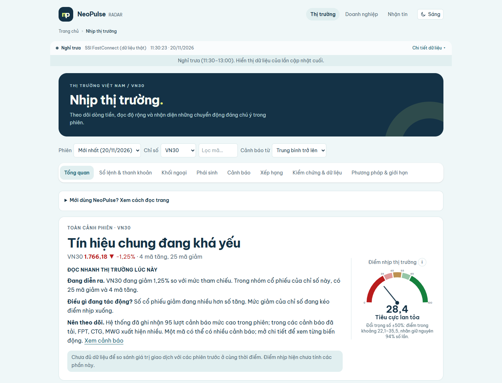
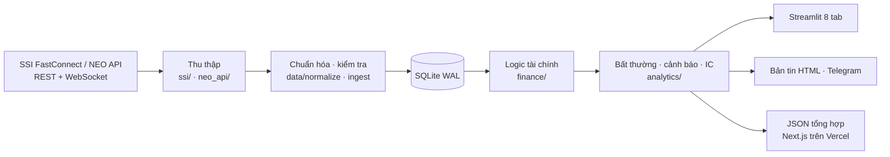
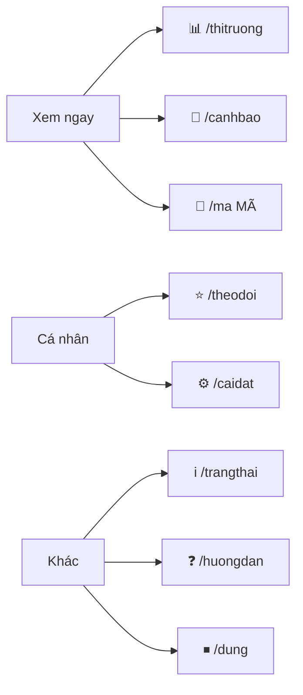

# NeoPulse Radar

Radar nội phiên cho thị trường cổ phiếu Việt Nam: đo nhịp thị trường, áp lực sổ lệnh, thanh khoản, dòng tiền khối ngoại và basis phái sinh, rồi phát cảnh báo khi một mã lệch khỏi mức bình thường của chính nó trong phiên. Dữ liệu được ghi theo thời gian thực vào SQLite, mọi chỉ báo tính bằng Python, và giao diện chỉ hiển thị kết quả đã tổng hợp.

Đồ án cá nhân cuối kỳ, học phần *Gói phần mềm ứng dụng cho tài chính 1* (261BFF4011), Khoa Tài chính – Ngân hàng, Trường Đại học Kinh tế - Luật.

> Công cụ phân tích học thuật. Không phải lời khuyên đầu tư. Hệ thống không đặt lệnh: các API giao dịch và tài khoản bị chặn trong mã nguồn.

[](https://github.com/thienanpham160806-code/neopulse-radar/actions/workflows/ci.yml)
[](https://www.python.org/)
[](web/README.md)
[](#dữ-liệu)
[](tests/)
[](LICENSE)

**[Bản web](https://neopulse-radar.vercel.app)** · **[Phương pháp](docs/methodology.md)** · **[Kiến trúc](docs/architecture.md)** · **[Dàn ý báo cáo](report/README.md)**


*Bản web với dữ liệu SSI FastConnect thật, lần cập nhật 11:30 ngày 20/11/2026.*

## Kết quả chính

- **Dữ liệu thật đã thu.** Bộ ghi SSI FastConnect đã ghi 3 phiên (19/11, 20/11 và 23/11/2026), tổng cộng 587.084 bản ghi giá và sổ lệnh của 31 mã (rổ VN30 và chỉ số) vào SQLite. Phiên 19/11 bắt đầu muộn; phiên 23/11 thiếu đoạn 09:00–10:16 do tác vụ ghi không tự khởi động. Mục tiêu tối thiểu là 5 phiên trước khi kiểm chứng ngoài mẫu.
- **Đã thử kết nối NEO API thật.** Đăng nhập `/auth/token` thành công, nhưng mọi API dữ liệu trả `NEOINP000401` vì NEO bắt buộc đăng ký IP (IP whitelist). Mạng ký túc xá dùng IP động nên không đăng ký được. Endpoint và header của mã nguồn khớp tài liệu v1.0.0; chi tiết lần thử ở [`docs/neo_api_notes.md`](docs/neo_api_notes.md).
- **Một sản phẩm, hai nguồn.** Khung tin SSI được `ssi/adapter.py` đổi về cùng lược đồ thô với NEO, nên chuẩn hóa, lưu trữ, logic tài chính và giao diện dùng chung. Đổi nguồn bằng một biến `NEOPULSE_SOURCE`.
- **Kiểm thử.** 243 ca kiểm thử offline: công thức so với giá trị tính tay, không nhìn trước tương lai, dữ liệu bẩn, đăng nhập lại khi 401, WebSocket rớt hoặc treo, chặn endpoint giao dịch, che bí mật trong log.
- **Web công khai không lộ dữ liệu thô.** Bản web trên Vercel chỉ nhận JSON chỉ báo tổng hợp; khóa SSI/NEO và bảng giá từng tick ở lại máy ghi.

## Đáp ứng yêu cầu đề bài

| Yêu cầu | Cách hệ thống đáp ứng |
|---|---|
| Dữ liệu từ API | REST + WebSocket, đăng nhập JWT, tự làm mới token, giới hạn tần suất, thử lại, tự nối lại; NEO (`neo_api/`) và SSI (`ssi/`) |
| Ít nhất 2 nhóm API | Cổ phiếu (`stockDetail`, `stockDetailByIndex`, `fuStockDetail`) và thị trường (`marketIndexDetail`, `marketStatus`), thêm luồng WebSocket |
| Làm sạch và lưu trữ | Ép kiểu, kiểm tra miền giá trị, khử lặp, loại tin đến muộn, SQLite chế độ WAL, nhật ký chất lượng — `data/` |
| Logic tài chính | Spread, OBI, microprice, trượt giá, độ rộng, khối ngoại, basis, điểm nhịp — `finance/` |
| Phân tích và cảnh báo | z-score bền vững, cảnh báo có mức ưu tiên, xếp hạng, IC trong và ngoài mẫu, bản tin HTML — `analytics/` |
| Giao diện | Dashboard Streamlit 8 tab (`app/`) và bản web Next.js (`web/`) |
| Gợi ý của đề được kết hợp | 1 (nhịp thị trường), 3 (thanh khoản), 4 (mất cân bằng sổ lệnh), 5 (khối ngoại), 6–7 (bất thường và cảnh báo), 10 (basis), 11 (bộ ghi dữ liệu), 14 (diễn giải có rào chắn) |
| Sử dụng có trách nhiệm | Không đặt lệnh, không khuyến nghị MUA/BÁN, dữ liệu mô phỏng luôn gắn nhãn, bí mật không rời máy |

## Dữ liệu

| Nguồn | Nội dung | Trạng thái |
|---|---|---|
| [SSI FastConnect Data v3](https://developers.ssi.com.vn) | REST (`securitiesByBoard`, chỉ số, lịch sử ngày) và streaming giá, sổ lệnh 3 mức, khối ngoại, chỉ số | Nguồn dữ liệu thật đang dùng, ghi từ 19/11/2026 |
| [NEO API v1.0.0 (VPBankS)](https://neoinvest.vpbanks.com.vn/neo-openapi/docs/overview) | `stockDetail*`, `marketIndexDetail`, `marketStatus`; WebSocket `stockInfo`, `marketInfo`, `marketSession` | Lớp kết nối hoàn chỉnh, kiểm thử bằng máy chủ giả; chờ IP được whitelist |
| [vnstock](https://github.com/thinh-vu/vnstock) (Vietcap) | Phân ngành, khối lượng trung bình 20 phiên, báo cáo tài chính năm cho trang doanh nghiệp | Chỉ làm dữ liệu tham chiếu và dự phòng |
| Bộ mô phỏng (`neo_api/sim.py`) | Phiên giả lập có sự kiện cài sẵn để kiểm thử độ thu hồi cảnh báo | Luôn ghi `source='sim'`, giao diện gắn nhãn MÔ PHỎNG |

Hơn 30 trường có ý nghĩa tài chính được khai thác: giá và khối lượng 3 mức, khối lượng và giá trị lũy kế, mua/bán/room nước ngoài, số mã tăng/giảm/trần/sàn, OI, ngày đáo hạn. Từ điển dữ liệu: [`docs/data_dictionary.md`](docs/data_dictionary.md). Ghi chú API: [`docs/neo_api_notes.md`](docs/neo_api_notes.md), [`docs/ssi_notes.md`](docs/ssi_notes.md).

Tệp SQLite, `raw_dump/`, `out/` và `web/public/data/` không lưu trong Git.

## Phương pháp



| Chỉ báo | Công thức |
|---|---|
| Spread | (bán₁ − mua₁) / giá giữa × 10⁴ |
| OBI₃ | (ΣKL mua − ΣKL bán) / (ΣKL mua + ΣKL bán) trên 3 mức |
| Microprice | (bán₁·KLmua₁ + mua₁·KLbán₁) / (KLmua₁ + KLbán₁) |
| Trượt giá | Đi qua 3 mức giá cho một lệnh giả định, so với giá giữa |
| Khối ngoại ròng/tổng | (mua − bán) / (mua + bán) |
| Basis | F − S; quy năm (F/S − 1)·365/số ngày tới đáo hạn |
| Bất thường | z = 0,6745·(x − median)/MAD trên 60 thanh trước đó; ngưỡng 3,5 |
| Điểm nhịp | 50 + 50·Σwᵢcᵢ: độ rộng 30%, động lượng 25%, sổ lệnh 20%, khối ngoại 15%, thanh khoản 10% |

Nguyên tắc tính toán:

- **Không nhìn trước tương lai.** Mọi thống kê nền (median, MAD, khối lượng kỳ vọng) chỉ dùng dữ liệu trước thời điểm đang xét.
- **So với chính mã đó.** Ngưỡng bất thường đo theo phân phối trong phiên của từng mã, không dùng một ngưỡng chung cho cả rổ.
- **Python tính, giao diện chỉ hiển thị.** Web và dashboard không tính lại công thức tài chính; thiếu dữ liệu thì hiện "chưa có", không bịa số.
- **Kiểm chứng ngoài mẫu.** IC của tín hiệu được tách theo thời gian (trong mẫu và ngoài mẫu), báo cáo kể cả khi kết quả yếu.

Đầy đủ công thức, giả định, cơ sở ngưỡng và tài liệu tham khảo: [`docs/methodology.md`](docs/methodology.md).

## Cài đặt và tái lập

Cần **Python ≥ 3.10**. **Node.js ≥ 20** chỉ cần khi build lại bản web trong `web/`. Chạy mọi lệnh từ gốc repo.

**Windows (PowerShell)**
```powershell
py -m venv .venv
.\.venv\Scripts\Activate.ps1
python -m pip install -r requirements.txt
python -m pip install -e .
copy .env.example .env
```

**macOS / Linux**
```bash
python3 -m venv .venv
source .venv/bin/activate
python -m pip install -r requirements.txt
python -m pip install -e .
cp .env.example .env
```

**Chạy thử không cần tài khoản (dữ liệu mô phỏng)**
```bash
neopulse simulate --sessions 6 --reset       # sinh 6 phiên MÔ PHỎNG
streamlit run src/neopulse/app/dashboard.py  # dashboard 8 tab
neopulse briefing                            # bản tin HTML vào out/
neopulse validate                            # báo cáo kiểm chứng
python -m pytest -q                          # 243 kiểm thử offline
```

**Chạy với dữ liệu thật (SSI FastConnect)**

1. Đăng nhập [developers.ssi.com.vn](https://developers.ssi.com.vn), vào *Quản lý API Key*, tạo key mới và lưu API Secret ngay (chỉ hiện một lần).
2. Điền `.env`: `NEOPULSE_MODE=live`, `NEOPULSE_SOURCE=ssi`, `SSI_API_KEY`, `SSI_API_SECRET`, và tùy chọn `NEOPULSE_FUTURES=VN30F2612`.
3. `neopulse check` để kiểm tra kết nối (chỉ in trạng thái đã/chưa điền bí mật).
4. `neopulse record` trong giờ giao dịch (tự dừng 15:05). Trên Windows có thể giao cho Task Scheduler bằng `scripts/run_record_session.ps1`.

Gói chuẩn bị cho bộ thu chạy độc lập trên cloud: [`deploy/collector/`](deploy/collector/README.md). **Chưa kích hoạt**: cần xác minh gói miễn phí không thẻ có đủ RAM và lưu trữ bền, chuyển dữ liệu/Secret sau xác nhận, rồi thử thu thật. Khi chưa nghiệm thu, laptop vẫn là nơi ghi dữ liệu.
5. Sau phiên: `neopulse briefing --source ssi`, `neopulse alerts --source ssi`; sau ≥ 5 phiên: `neopulse validate --source ssi`.

**Chạy với NEO API** (khi IP của máy đã được VPBankS đăng ký): điền `NEO_USERNAME`, `NEO_PASSWORD`, đặt `NEOPULSE_SOURCE=neo`, rồi chạy cùng các lệnh trên. Danh sách việc cần xác nhận ở lần chạy đầu: [`docs/live_checklist.md`](docs/live_checklist.md).

**Xuất bản web**
```bash
neopulse publish-static --source ssi            # ghi JSON tổng hợp vào web/public/data/
neopulse publish-static --source ssi --deploy   # ghi rồi triển khai lên Vercel
```

Web hiển thị bản dữ liệu tĩnh (snapshot) và nhận cập nhật trực tiếp qua Ably khi bật `neopulse live-relay`. Chi tiết: [`docs/web_architecture.md`](docs/web_architecture.md).

<details>
<summary>Biến môi trường</summary>

| Biến | Bắt buộc | Ý nghĩa |
|---|---|---|
| `NEOPULSE_MODE` | ✓ | `sim` hoặc `live` |
| `NEOPULSE_SOURCE` | live | `neo` (mặc định) hoặc `ssi` |
| `SSI_API_KEY`, `SSI_API_SECRET` | ssi | Khóa tạo tại developers.ssi.com.vn (tên cũ `SSI_CONSUMER_*` vẫn được đọc) |
| `SSI_API_URL`, `SSI_STREAM_URL`, `SSI_MAX_RPS`, `SSI_PRICE_SCALE` | – | Địa chỉ dịch vụ SSI, giới hạn tần suất (mặc định 5), hệ số giá |
| `NEO_USERNAME`, `NEO_PASSWORD` | neo | Đăng nhập `/auth/token` |
| `NEO_ACCESS_TOKEN` | – | JWT dán sẵn, thay cho username/password |
| `NEO_AUTH_URL`, `NEO_BASE_URL`, `NEO_WS_MARKET_URL` | – | Mặc định theo tài liệu NEO API v1.0.0 |
| `NEO_DEVICE_ID`, `NEO_DEVICE_TYPE` | – | Header `x-device`, `x-devicetype` |
| `NEO_MAX_RPS` | – | Giới hạn phía client, tối đa 5 (mặc định 4) |
| `NEOPULSE_UNIVERSE_INDEX`, `NEOPULSE_EXTRA_SYMBOLS`, `NEOPULSE_INDEXES` | – | Rổ theo dõi |
| `NEOPULSE_FUTURES` | – | Mã HĐTL, ví dụ `VN30F2612` (ngày đáo hạn tự suy: thứ Năm thứ ba của tháng) |
| `NEOPULSE_DB_PATH` | – | Tệp SQLite |
| `TELEGRAM_BOT_TOKEN`, `TELEGRAM_CHAT_ID` | – | Gửi cảnh báo mức CAO |
| `LLM_API_KEY`, `LLM_MODEL` | – | Diễn giải bằng mô hình ngôn ngữ, có kiểm tra số liệu |
| `ABLY_API_KEY` | – | Cập nhật trực tiếp cho bản web |
| `BLOB_READ_WRITE_TOKEN`, `BLOB_PREFIX` | – | Chỉ cho `neopulse publish` (Vercel Blob, tốn hạn mức) |

</details>

## Cấu trúc thư mục

```
src/neopulse/neo_api/   kết nối NEO API: JWT, giới hạn tần suất, WebSocket, bộ mô phỏng
src/neopulse/ssi/       kết nối SSI FastConnect và bộ chuyển khung tin về lược đồ chung
src/neopulse/data/      chuẩn hóa, kiểm tra, lưu SQLite, bộ ghi
src/neopulse/finance/   spread, OBI, microprice, trượt giá, độ rộng, khối ngoại, basis, điểm nhịp
src/neopulse/analytics/ bất thường, cảnh báo, xếp hạng, kiểm chứng IC, bản tin, xuất JSON web
src/neopulse/app/       dashboard Streamlit
web/                    giao diện Next.js trên Vercel, chỉ hiển thị JSON do Python xuất
scripts/                lịch ghi phiên trên Windows
tests/                  kiểm thử offline (máy chủ giả, không cần mạng)
data_sample/            dữ liệu MÔ PHỎNG mẫu
docs/                   kiến trúc, phương pháp, từ điển dữ liệu, kế hoạch kiểm thử, ghi chú API
report/                 dàn ý báo cáo theo khung của đề
```

## Đầu ra

- Dashboard Streamlit 8 tab: Tổng quan, Sổ lệnh & thanh khoản, Khối ngoại, Phái sinh, Cảnh báo, Xếp hạng, Kiểm chứng & dữ liệu, Phương pháp & giới hạn.
- Bản web: [neopulse-radar.vercel.app](https://neopulse-radar.vercel.app).
- Bản tin cuối phiên dạng HTML ([mẫu mô phỏng](docs/sample_briefing_sim.html)) và cảnh báo mức CAO qua Telegram.
- Báo cáo kiểm chứng: IC trong và ngoài mẫu, IC từng phiên, chất lượng dữ liệu, độ thu hồi cảnh báo.
- Ảnh chụp giao diện: [`docs/img/`](docs/img/). Các ảnh có hậu tố `_sim` dùng dữ liệu mô phỏng.

## Bot Telegram

Bot `@neopulse_warningbot` đọc nhanh kết quả NeoPulse và gửi tin theo lựa chọn của người dùng. Số liệu lấy từ cùng nguồn với website (`/api/data`, catalog doanh nghiệp), nên con số trên bot khớp con số trên web. Bot không tính lại chỉ báo và không khuyến nghị mua/bán.



| Lệnh | Việc | Cần đăng ký |
|---|---|---|
| `/thitruong` | Nhịp thị trường VN30: điểm nhịp, chỉ số, căn cứ, bối cảnh | Không |
| `/canhbao` | Cảnh báo trong phiên, lọc mức bằng nút | Không |
| `/ma HPG` (hoặc gõ mã) | Thẻ một mã: giá, cảnh báo, khối ngoại, nút mở hồ sơ | Không |
| `/theodoi` | Xem, thêm, bớt mã theo dõi | Có |
| `/caidat` | Bật/tắt cảnh báo mức cao, tin doanh nghiệp, tin chính sách, tóm tắt đầu và cuối phiên | Có |
| `/trangthai`, `/huongdan` | Trạng thái dữ liệu, hướng dẫn | Không |
| `/start`, `/dung` | Đăng ký (mặc định chỉ cảnh báo mức cao), hủy đăng ký | — |

Lệnh cũ (`/market`, `/alerts`, `/company`, `/watch`, `/all`, `/status`, `/help`, `/stop`) vẫn dùng được và có kèm tên lệnh mới. Quy ước icon và cấu trúc tin: [`docs/bot_style.md`](docs/bot_style.md); mẫu tin: [`docs/bot_samples.md`](docs/bot_samples.md); rà soát và lý do thiết kế: [`docs/bot_audit.md`](docs/bot_audit.md).

Ví dụ một cảnh báo tự động (dữ liệu mô phỏng):

```text
🚨 [MÔ PHỎNG] Độ chênh giá mua-bán giãn rộng · VIB · 14:28
VIB: độ chênh giá mua-bán giãn rộng bất thường; giá 41.600 🔴 ▼ −0,95%.
Căn cứ: điểm z bền vững vượt 50 (ngưỡng 3,5): lệch rất xa so với mức thường thấy trong phiên.
Bối cảnh: VN30 1.967,70 🟢 ▲ +0,45% · 20 mã tăng / 9 mã giảm / 1 đứng giá.
[🏢 Thẻ VIB] [🔗 Xem VIB trên NeoPulse]
Bộ mô phỏng · Dữ liệu MÔ PHỎNG · Không phải lời khuyên đầu tư
```

**Vận hành.** Webhook `web/api/telegram.py` trả lời lệnh và nút bấm ngay. Tin tự động gửi theo đợt qua `web/api/telegram_tick.py`: bộ phát trực tiếp gọi khoảng mỗi phút trong giờ giao dịch, cron ngoài gọi mỗi 5 phút, GitHub Actions là dự phòng. Khóa Redis chặn hai lượt chạy song song. Đăng ký lưu trong Redis, mã hóa Fernet, ghi có điều kiện (CAS), không xử lý lại update cũ.

**Cấu hình** (biến môi trường trên Vercel, không đưa vào Git): `TELEGRAM_BOT_TOKEN`, `TELEGRAM_WEBHOOK_SECRET`, `TELEGRAM_STATE_KEY`, `TELEGRAM_TICK_SECRET`, `KV_REST_API_URL`, `KV_REST_API_TOKEN`. Sau khi đổi lệnh, chạy `python tools/configure_telegram_profile.py` (mô tả bot và menu lệnh) và gọi `/api/telegram_tick?setup=webhook` có header `Authorization: Bearer <TELEGRAM_TICK_SECRET>` để webhook nhận cả nút bấm.

## Hạn chế

- Mới thu 3 phiên dữ liệu thật, hai phiên không trọn vẹn; kiểm chứng ngoài mẫu cần ít nhất 5 phiên. Các hình và số minh họa có hậu tố `_sim` là mô phỏng.
- Chưa lấy được dữ liệu NEO API thật vì yêu cầu IP whitelist; dữ liệu thật hiện đến từ SSI FastConnect.
- SSI: giao thức streaming lấy từ mã nguồn SDK chính thức vì tài liệu web không mô tả; các điểm chưa kiểm chứng ở [`docs/ssi_notes.md`](docs/ssi_notes.md).
- Tin giá không có dấu thời gian sự kiện nên dùng thời điểm nhận (giờ Việt Nam); độ trễ mạng lẫn vào chuỗi.
- Chỉ có 3 mức giá: OBI và độ sâu là xấp xỉ, trượt giá là cận dưới.
- Khối ngoại và sổ lệnh tính trên rổ theo dõi, không phải toàn thị trường.
- Trọng số điểm nhịp là lựa chọn thiết kế; điểm mô tả hiện trạng, không dự báo.
- IC chưa trừ spread và phí; t-stat chưa hiệu chỉnh tự tương quan.
- Chưa có lịch nghỉ lễ; SQLite phù hợp một máy, một bộ ghi.

## Bảo mật

- Bí mật chỉ nằm trong `.env` (đã `.gitignore`); token chỉ giữ trong bộ nhớ, không ghi đĩa.
- Log đi qua bộ lọc che JWT, Bearer và mật khẩu; `neopulse check` chỉ in trạng thái đã/chưa điền.
- Khóa SSI/NEO không đưa lên Vercel hay vào mã web; web chỉ nhận JSON chỉ báo tổng hợp.
- Nếu lỡ lộ thông tin đăng nhập: đổi mật khẩu hoặc thu hồi khóa ngay và báo giảng viên.

## Trích dẫn

```bibtex
@misc{pham2026neopulse,
  author       = {Phạm Ngọc Thiên An},
  title        = {NeoPulse Radar: Radar nhịp thị trường, áp lực sổ lệnh và cảnh báo bất thường nội phiên},
  year         = {2026},
  howpublished = {GitHub repository},
  url          = {https://github.com/thienanpham160806-code/neopulse-radar}
}
```

## Tác giả, giấy phép và quy trình

**Phạm Ngọc Thiên An** (K244141653) · Trường Đại học Kinh tế - Luật, Đại học Quốc gia Thành phố Hồ Chí Minh.

Giấy phép MIT ([`LICENSE`](LICENSE)). Thư viện chính: httpx, websockets, pandas, numpy, Streamlit, Plotly, Jinja2, Next.js, Recharts (giấy phép mã nguồn mở tương ứng). Có sử dụng trợ lý AI (Claude) hỗ trợ lập trình và biên tập; tác giả chịu trách nhiệm về toàn bộ mã nguồn và nội dung.

<details>
<summary>Tái sử dụng từ dự án cũ của tác giả</summary>

Chỉ đọc thư mục nguồn, chép có chọn lọc và ghi rõ đã sửa gì. Không chép mã từ `Kumo_VN_bot` (đồ án nhóm); bot Telegram chỉ tham khảo cách tổ chức handlers, menu và formatters của Kumo (`src/neopulse/analytics/telegram_ui.py`), viết lại trên dữ liệu và kiến trúc webhook của NeoPulse. Không mang sang tín hiệu MACD/RSI/Ichimoku hay khuyến nghị MUA/BÁN.

| Tệp trong repo này | Lấy từ | Đã sửa |
|---|---|---|
| `web/src/app/fonts/BeVietnamPro-*.ttf`, `OFL.txt` | `invest-system-phase2/assets/fonts/` | Chỉ lấy 4 độ đậm (bỏ Italic); giữ nguyên giấy phép SIL OFL 1.1 |
| Cấu hình `localFont` trong `web/src/app/layout.tsx` | `invest-system-phase2/app/layout.tsx` | Đổi đường dẫn, bỏ Italic, bỏ header/script riêng của dự án cũ |
| `web/src/lib/fmt.ts` | `invest-system-phase2/lib/fmt.ts` | Giữ `bnLabel`, `dmy` (đổi tên `dmyTime`), `cls`; **bỏ `RATING_COLOR`** (MUA/BÁN); thêm màu trần tím, sàn xanh lơ, ký hiệu ▲▼■; phần trăm đổi sang đơn vị % |
| `web/src/components/ThemeToggle.tsx` | `invest-system-phase2/components/ThemeToggle.tsx` | Khóa lưu `np-theme`, mặc định theo `prefers-color-scheme`, bỏ sự kiện riêng, dùng token màu của dự án này |
| Danh sách mã tham chiếu trong `src/neopulse/finance/sectors.py` | `invest-system-phase2/config/sector_map.yaml` (`static_types`) | Chỉ giữ 4 nhóm tài chính; chỉ dùng để phân loại khi thiếu mã ICB, không làm dữ liệu số; thêm BCM |
| Cách nạp lười `vnstock` + chặn `SystemExit` trong `src/neopulse/analytics/refdata.py` | `invest-system-phase2/src/invest_system/data/vietcap.py` (`VietcapProvider._modules/_guard`) | Rút gọn thành một hàm lấy khối lượng ngày, chỉ làm **dự phòng** khi REST SSI lỗi |

Không dùng: `components/DataTable.tsx` (kéo theo `@tanstack/react-table`, `react-virtual`, quá nặng cho bảng 30 dòng); `components/Charts.tsx` (biểu đồ Recharts sẵn có đã đủ); `market_universe.parquet` (phân ngành lấy trực tiếp từ `icbCode/icbName` của SSI `securitiesByBoard`, mới hơn); DNSE (cần khóa riêng).

</details>
