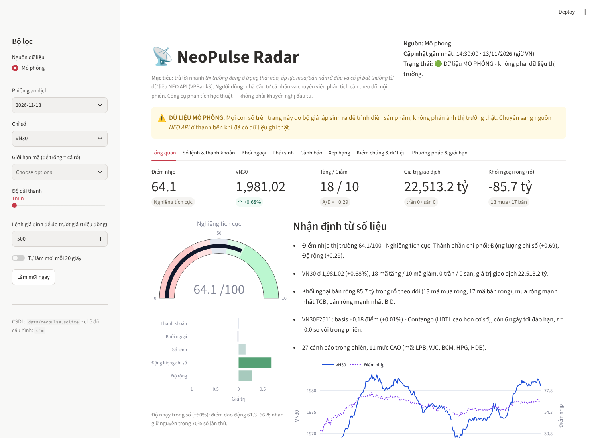

# NeoPulse Radar

**Radar nhịp thị trường, áp lực sổ lệnh và cảnh báo bất thường nội phiên trên NEO API (VPBankS).**

Đồ án cá nhân cuối kỳ — học phần *Gói phần mềm ứng dụng cho tài chính 1* (261BFF4011), Khoa Tài chính – Ngân hàng, Trường ĐH Kinh tế – Luật.
Tác giả: Phạm Ngọc Thiên An — K244141653.

> Công cụ phân tích học thuật. **Không phải khuyến nghị đầu tư. Không đặt lệnh** — các endpoint giao dịch của NEO API bị chặn cứng trong mã nguồn.

---

## 1. Vấn đề và người dùng

Trong phiên, nhà đầu tư cá nhân nhìn bảng giá và thấy *rất nhiều số* nhưng thiếu ba câu trả lời:

1. **Thị trường đang ở trạng thái nào?** Chỉ số tăng nhờ lan tỏa hay nhờ vài mã trụ?
2. **Áp lực mua/bán đang nằm ở đâu?** Mã nào sổ lệnh lệch hẳn một phía, mã nào mỏng đến mức một lệnh vừa phải cũng trượt giá?
3. **Có gì bất thường vừa xảy ra?** Khối lượng, spread, dòng tiền nước ngoài lệch khỏi mức bình thường *của chính mã đó* trong phiên.

NeoPulse Radar trả lời ba câu đó từ dữ liệu NEO API, kèm công thức, ngưỡng có cơ sở và phần kiểm chứng.

| | |
|---|---|
| **Người dùng** | Nhà đầu tư cá nhân theo dõi nội phiên; chuyên viên phân tích cần bản tin cuối phiên |
| **Đầu ra** | Điểm nhịp thị trường 0–100 · bản đồ áp lực sổ lệnh · bảng thanh khoản & trượt giá · radar khối ngoại · basis VN30F · cảnh báo có mức ưu tiên · bản tin HTML |
| **Gợi ý của đề được kết hợp** | 1 (nhịp thị trường), 3 (thanh khoản), 4 (mất cân bằng sổ lệnh), 5 (khối ngoại), 6–7 (bất thường & cảnh báo), 10 (basis), 11 (bộ ghi dữ liệu), 14 (diễn giải có rào chắn) |


*Ảnh chụp với dữ liệu mô phỏng — thay bằng ảnh dữ liệu NEO API thật khi đã thu.* Bản tin mẫu: [`docs/sample_briefing_sim.html`](docs/sample_briefing_sim.html).

## 2. Kiến trúc

```
NEO API ──► Thu thập ──► Chuẩn hóa / kiểm tra ──► SQLite ──► Logic tài chính ──► Phân tích ──► Giao diện
REST + WS   neo_api/     data/normalize, ingest   storage    finance/            analytics/    app/ + bản tin
```

| Lớp | Thư mục | Nhiệm vụ |
|---|---|---|
| Kết nối | `src/neopulse/neo_api/` | Đăng nhập JWT, tự làm mới token, giới hạn 5 req/s, thử lại, WebSocket tự nối lại, bộ mô phỏng |
| Dữ liệu | `src/neopulse/data/` | Ép kiểu, kiểm tra miền giá trị, khử lặp, loại tin đến muộn, lưu SQLite (WAL), bộ ghi |
| Tài chính | `src/neopulse/finance/` | Spread, OBI, microprice, trượt giá, độ rộng, khối ngoại, basis, điểm nhịp |
| Phân tích | `src/neopulse/analytics/` | z-score bền vững, cảnh báo, xếp hạng, kiểm chứng IC, bản tin, diễn giải |
| Giao diện | `src/neopulse/app/` | Dashboard Streamlit 8 tab |

Sơ đồ chi tiết: [`docs/architecture.md`](docs/architecture.md).

## 3. Cài đặt

Yêu cầu Python ≥ 3.10.

```bash
python -m venv .venv && source .venv/bin/activate      # Windows: .venv\Scripts\activate
pip install -r requirements.txt
pip install -e .
cp .env.example .env                                   # Windows: copy .env.example .env
```

## 4. Chạy thử ngay (không cần tài khoản)

```bash
neopulse simulate --sessions 6 --reset     # sinh 6 phiên dữ liệu MÔ PHỎNG
streamlit run src/neopulse/app/dashboard.py
neopulse briefing                          # xuất out/briefing_sim_<ngày>.html
neopulse validate                          # báo cáo kiểm chứng
pytest                                     # 94 kiểm thử tự động
```

Dữ liệu mô phỏng luôn mang `source='sim'` và giao diện luôn hiện nhãn **MÔ PHỎNG**.

## 5. Chạy với NEO API thật

**Điều kiện:** tài khoản VPBankS đã được gán quyền NeoAPI và đăng ký IP của máy chạy.

1. Mở `.env`, điền phần **[ĐIỀN Ở ĐÂY]**:

   ```ini
   NEOPULSE_MODE=live
   NEO_USERNAME=<số lưu ký>
   NEO_PASSWORD=<mật khẩu>
   # hoặc dán sẵn token:  NEO_ACCESS_TOKEN=<jwt>
   ```

2. Kiểm tra kết nối (không in bí mật): `neopulse check`
3. Ghi dữ liệu trong giờ giao dịch: `neopulse record` (tự dừng 15:05; `Ctrl+C` để dừng sớm)
   Dự phòng nếu WebSocket không vào được: `neopulse poll --interval 15`
4. Mở dashboard ở cửa sổ khác: `streamlit run src/neopulse/app/dashboard.py` → chọn nguồn *NEO API*.
5. Cuối phiên: `neopulse briefing` · `neopulse alerts --notify` (nếu đã điền Telegram) · sau ≥ 5 phiên: `neopulse validate --source neo`

Danh sách việc cần xác nhận ở lần chạy thật đầu tiên: [`docs/live_checklist.md`](docs/live_checklist.md).

### Biến môi trường

| Biến | Bắt buộc | Ý nghĩa |
|---|---|---|
| `NEOPULSE_MODE` | ✓ | `sim` hoặc `live` |
| `NEO_USERNAME`, `NEO_PASSWORD` | live | Đăng nhập `/auth/token` |
| `NEO_ACCESS_TOKEN` | – | JWT dán sẵn (thay cho username/password) |
| `NEO_AUTH_URL`, `NEO_BASE_URL`, `NEO_WS_MARKET_URL` | – | Mặc định theo tài liệu NEO API v1.0.0 |
| `NEO_DEVICE_ID`, `NEO_DEVICE_TYPE` | – | Header `x-device`, `x-devicetype` |
| `NEO_MAX_RPS` | – | Giới hạn phía client, tối đa 5 (mặc định 4) |
| `NEOPULSE_UNIVERSE_INDEX`, `NEOPULSE_EXTRA_SYMBOLS`, `NEOPULSE_INDEXES` | – | Rổ theo dõi |
| `NEOPULSE_DB_PATH` | – | Tệp SQLite |
| `TELEGRAM_BOT_TOKEN`, `TELEGRAM_CHAT_ID` | – | Gửi cảnh báo mức CAO |
| `LLM_API_KEY`, `LLM_MODEL` | – | Diễn giải bằng mô hình ngôn ngữ (có kiểm tra số liệu) |
| `SSI_CONSUMER_ID`, `SSI_CONSUMER_SECRET` | – | Điểm cắm SSI FastConnect (chưa triển khai) |

## 6. Dữ liệu NEO API được dùng

| Nhóm | Endpoint / kênh | Dùng để |
|---|---|---|
| Xác thực | `POST /auth/token` | Lấy JWT (hết hạn 3 giờ, tự làm mới trước 5 phút) |
| Cổ phiếu | `GET /stock/stockDetailByIndex`, `/stock/stockDetail`, `/stock/fuStockDetail` | Thành phần rổ, ảnh chụp đầu phiên, HĐTL, đối chiếu |
| Thị trường | `GET /market/marketIndexDetail`, `/market/marketStatus` | Chỉ số, độ rộng, trạng thái phiên |
| WebSocket | `stockInfo`, `marketInfo`, `marketSession` | Luồng chính nội phiên, có lưu trữ |

Hơn 30 trường có ý nghĩa tài chính được khai thác (giá 3 mức, khối lượng 3 mức, khối lượng/giá trị lũy kế, mua/bán/room nước ngoài, tăng/giảm/trần/sàn, OI, ngày đáo hạn…). Từ điển dữ liệu: [`docs/data_dictionary.md`](docs/data_dictionary.md). Ghi chú kỹ thuật về API: [`docs/neo_api_notes.md`](docs/neo_api_notes.md).

## 7. Phương pháp (tóm tắt)

| Chỉ báo | Công thức |
|---|---|
| Spread | (bán₁ − mua₁) / giá giữa × 10⁴ |
| OBI₃ | (ΣKL mua − ΣKL bán) / (ΣKL mua + ΣKL bán) trên 3 mức |
| Microprice | (bán₁·KLmua₁ + mua₁·KLbán₁) / (KLmua₁ + KLbán₁) |
| Trượt giá | đi qua 3 mức giá cho một lệnh giả định, so với giá giữa |
| NN ròng/tổng | (mua − bán) / (mua + bán) |
| Basis | F − S; quy năm (F/S − 1)·365/số ngày tới đáo hạn |
| Bất thường | z = 0,6745·(x − median)/MAD trên 60 thanh trước đó; ngưỡng 3,5 |
| Điểm nhịp | 50 + 50·Σwᵢcᵢ với độ rộng 30%, động lượng 25%, sổ lệnh 20%, khối ngoại 15%, thanh khoản 10% |

Đầy đủ công thức, giả định, cơ sở ngưỡng và tài liệu tham khảo: [`docs/methodology.md`](docs/methodology.md).

## 8. Kiểm thử và kiểm chứng

- `pytest` — 94 kiểm thử: chuẩn hóa dữ liệu bẩn, công thức với giá trị tính tay, không nhìn trước tương lai, giới hạn tần suất, đăng nhập lại khi 401, thử lại khi 5xx, chặn endpoint giao dịch, WebSocket rớt/treo/sai token, khử lặp, tin đến muộn, che bí mật trong log.
- `neopulse validate` — IC trong mẫu/ngoài mẫu (tách theo thời gian), IC từng phiên, chất lượng dữ liệu, độ thu hồi cảnh báo trên sự kiện cài sẵn.
- Kế hoạch và các tình huống lỗi đã thử: [`docs/test_plan.md`](docs/test_plan.md).

## 9. Giới hạn đã biết

- **Chưa chạy với NEO API thật.** Lớp kết nối được viết theo tài liệu v1.0.0 và kiểm thử bằng máy chủ giả; cần xác nhận lại ở lần chạy thật đầu tiên (xem `docs/live_checklist.md`). Mọi hình/số minh họa hiện có đều là mô phỏng.
- Tài liệu không mô tả phong bì của thông điệp WebSocket → bộ phân loại suy kênh từ tập trường; thông điệp lạ được ghi vào `raw_dump/` để hiệu chỉnh.
- `stockInfo` không có dấu thời gian sự kiện → dùng thời điểm nhận (giờ VN); độ trễ mạng lẫn vào chuỗi.
- Chỉ có 3 mức giá: OBI/độ sâu là xấp xỉ; trượt giá là cận dưới.
- Khối ngoại và sổ lệnh tính trên rổ theo dõi, không phải toàn thị trường.
- Trọng số điểm nhịp là lựa chọn thiết kế; điểm mô tả hiện trạng, không dự báo.
- IC chưa trừ spread/phí; t-stat chưa hiệu chỉnh tự tương quan.
- Chưa có lịch nghỉ lễ; SQLite phù hợp một máy, một bộ ghi.

## 10. Bảo mật

- Bí mật chỉ nằm trong `.env` (đã `.gitignore`); token chỉ giữ trong bộ nhớ, không ghi đĩa.
- Log đi qua bộ lọc che JWT/Bearer/mật khẩu; `neopulse check` chỉ in trạng thái đã/chưa điền.
- Không commit `data/`, `raw_dump/`, `out/`. Trước khi đẩy mã công khai: `git grep -nE "eyJ|password\s*=" -- . ':!.env.example'`.
- Nếu lỡ lộ thông tin đăng nhập: đổi mật khẩu VPBankS ngay và báo giảng viên.

## 11. Cấu trúc thư mục

```
neopulse-radar/
├── README.md · requirements.txt · pyproject.toml · .env.example · Makefile
├── src/neopulse/
│   ├── neo_api/     client.py  ws.py  ratelimit.py  errors.py  sim.py
│   ├── data/        normalize.py  ingest.py  storage.py  recorder.py
│   ├── finance/     microstructure.py  breadth.py  foreign.py  basis.py  pulse.py
│   ├── analytics/   anomaly.py  alerts.py  ranking.py  validation.py  view.py  briefing.py  explain.py  notify.py
│   ├── app/         dashboard.py
│   ├── providers/   ssi.py (điểm cắm)
│   └── cli.py  config.py  timeutil.py  logging_setup.py
├── tests/           94 kiểm thử
├── data_sample/     dữ liệu MÔ PHỎNG mẫu
├── docs/            kiến trúc, phương pháp, từ điển dữ liệu, kế hoạch thử, checklist chạy thật
└── report/          dàn ý báo cáo theo khung của đề
```

## 12. Nguồn và ghi nhận

- Tài liệu NEO API: <https://neoinvest.vpbanks.com.vn/neo-openapi/docs/overview> (v1.0.0, truy cập 14/11/2026).
- Thư viện: httpx, websockets, pandas, numpy, Streamlit, Plotly, Jinja2 (giấy phép mã nguồn mở tương ứng).
- Có sử dụng trợ lý AI (Claude) hỗ trợ lập trình và biên tập; tác giả chịu trách nhiệm về toàn bộ mã nguồn và nội dung.
- Giấy phép: MIT.
