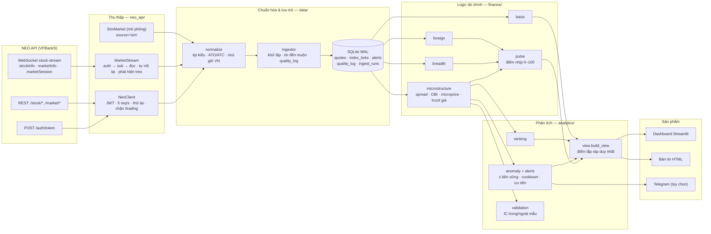

# Kiến trúc

## Quyết định thiết kế

| Quyết định | Lý do |
|---|---|
| **Bộ ghi và giao diện là hai tiến trình tách rời, nối nhau qua SQLite** | API lỗi/mất kết nối không làm treo giao diện; giao diện chỉ thấy dữ liệu "cũ đi" và báo rõ. SQLite WAL cho phép ghi và đọc đồng thời. |
| **WebSocket là luồng chính, REST chỉ để khởi tạo và đối chiếu** | Đề yêu cầu ưu tiên WebSocket cho thời gian thực; REST định kỳ ~3 request/phút, xa giới hạn 5 req/s. |
| **Một điểm lắp ráp `build_view`** | Dashboard, bản tin và kiểm thử dùng cùng một phép tính — không có chuyện số trên màn hình khác số trong báo cáo. |
| **Hàm tài chính là hàm thuần trên DataFrame** | Kiểm thử bằng giá trị tính tay, không cần mạng hay CSDL. |
| **Bộ mô phỏng phát thông điệp đúng lược đồ thô của NEO API** | Dữ liệu mô phỏng đi qua đúng đường ống chuẩn hóa như dữ liệu thật; cột `source` giữ hai loại tách bạch. |
| **Không có mã đặt lệnh** | Quy định an toàn của đề; `NeoClient.get` từ chối mọi đường dẫn `/trading/orders`. |
| **Bí mật chỉ đi qua `config.Settings`** | Một chỗ duy nhất để che khi log; token không ghi đĩa. |

## Luồng xử lý một thông điệp

1. `MarketStream` nhận chuỗi JSON → `classify_message` xác định kênh.
2. `Ingestor.handle` gọi `normalize_quote` / `normalize_index`: ép kiểu, đổi `dd/mm/YYYY`, gắn giờ VN, gắn cờ vấn đề.
3. Bản ghi hỏng (thiếu mã, không có giá) bị loại; bản ghi lặp nguyên văn bị bỏ; bản ghi có khối lượng lũy kế giảm trong cùng phiên bị coi là đến muộn. Tất cả được đếm và ghi `quality_log`.
4. Gom lô 500 bản ghi hoặc 5 giây → `INSERT OR IGNORE` (ràng buộc duy nhất `symbol, ts, source`).
5. Dashboard gọi `build_view` mỗi 20 giây: đọc phiên đang chọn, tính chỉ báo, cảnh báo, điểm nhịp.
