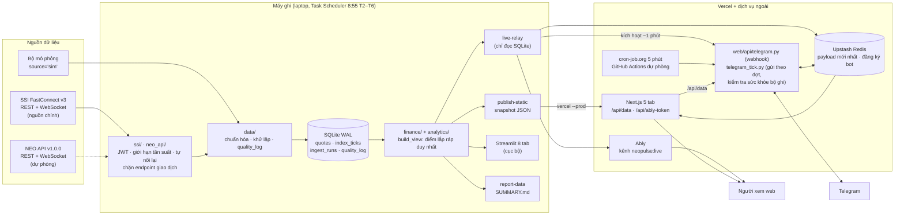

# Kiến trúc

Hiện trạng 25/11/2026: **SSI FastConnect là nguồn chính** (giảng viên đã chấp thuận thay NEO API), **NEO API là nguồn dự phòng** (lớp kết nối hoàn chỉnh, chưa lấy được dữ liệu vì cần IP cố định). Bộ ghi chạy trên laptop của tác giả; bản web, API và bot chạy trên Vercel.

## Quyết định thiết kế

| Quyết định | Lý do |
|---|---|
| **SSI làm nguồn chính, NEO giữ làm dự phòng** | NEO bắt buộc đăng ký IP cố định; mạng ký túc xá dùng IP động. `ssi/adapter.py` đổi khung tin SSI về cùng lược đồ thô với NEO, nên từ chuẩn hóa trở đi hai nguồn dùng chung mã. Đổi bằng biến `NEOPULSE_SOURCE`. |
| **Bộ ghi, phân tích và hiển thị tách tiến trình, nối qua SQLite** | API lỗi hay mất kết nối không làm treo giao diện; giao diện chỉ thấy dữ liệu "cũ đi" và báo rõ. SQLite WAL cho phép ghi và đọc đồng thời; `live-relay`, `publish-static`, `report-data` đều mở chỉ đọc. |
| **WebSocket là luồng chính, REST để khởi tạo và đối chiếu** | Ưu tiên dữ liệu thời gian thực; REST định kỳ ở mức vài request/phút, xa giới hạn của nhà cung cấp. |
| **Một điểm lắp ráp `build_view`** | Dashboard, bản web, bot, bản tin, `report-data` và kiểm thử dùng cùng một phép tính, nên số trên màn hình khớp số trong báo cáo. |
| **Python tính, web và bot chỉ hiển thị** | Không có công thức tài chính bằng JavaScript; web và bot đọc cùng payload `/api/data`. |
| **Khóa SSI/NEO không rời máy ghi** | Vercel chỉ nhận JSON chỉ báo tổng hợp (không sổ lệnh từng tick). Ably dùng token chỉ subscribe, hạn ngắn. |
| **Snapshot tĩnh + Ably thay cho đẩy liên tục lên Blob** | Hạn mức Vercel Blob gói Hobby quá thấp cho nhịp 20 giây; đường Blob (`neopulse publish`) còn trong mã như tùy chọn, chưa kiểm chứng với Blob thật. |
| **Bot gửi theo đợt, khóa Redis, ghi nhận đã gửi** | Webhook trả lời lệnh ngay; tin tự động gửi qua `telegram_tick` (bộ phát gọi ~1 phút, cron ngoài 5 phút). Khóa chặn hai lượt chạy song song, nên gọi dày không gửi trùng. |
| **Kiểm tra sức khỏe bộ ghi chạy trên cloud** | Laptop tắt thì không tự báo được; worker cloud đọc `meta.last_update` và nhắn riêng tác giả (`TELEGRAM_OWNER_CHAT_ID`) khi đến 09:05 chưa có dữ liệu hoặc im lặng quá 5 phút. |
| **Không có mã đặt lệnh** | Quy định an toàn của đề; client từ chối mọi đường dẫn giao dịch/tài khoản. |
| **Bí mật chỉ đi qua `config.Settings`** | Một chỗ duy nhất để che khi log; token không ghi đĩa. |

## Luồng xử lý một thông điệp

1. `ssi/ws.py` (hoặc `neo_api/ws.py`) nhận khung tin; `ssi/adapter.py` đổi về lược đồ thô chung và phân loại kênh.
2. `Ingestor.handle` gọi `normalize_quote` / `normalize_index`: ép kiểu, gắn giờ VN, gắn cờ vấn đề.
3. Bản ghi hỏng bị loại; bản ghi lặp nguyên văn bị bỏ; bản ghi có khối lượng lũy kế giảm trong cùng phiên bị coi là đến muộn. Tất cả được đếm vào `ingest_runs` và ghi `quality_log`.
4. Gom lô theo số bản ghi hoặc thời gian (`--flush-every 1` khi chạy cùng `live-relay`) → `INSERT OR IGNORE` (ràng buộc duy nhất `symbol, ts, source`).
5. `live-relay` đọc SQLite, gọi `build_view`, phát tin tổng hợp lên Ably và ghi payload mới nhất vào Redis; web và bot đọc payload đó qua `/api/data`.
6. Ngoài giờ hoặc khi mất tin trực tiếp quá 60 giây, web dùng snapshot tĩnh do `publish-static` triển khai.

Chi tiết bản web: [`web_architecture.md`](web_architecture.md). Bot: README mục "Bot Telegram" và [`bot_style.md`](bot_style.md).
