# Rà soát UX/UI & Đề xuất Cải tiến — NeoPulse Radar (`web/`)

- **Ngày thực hiện:** 23/11/2026
- **Nhánh làm việc:** `ui/refine` (tách từ `main` tại `a15d7ba`)
- **Môi trường kiểm thử:** Next.js 15.5.29 (`npm run build && npm run start`), dữ liệu mô phỏng phiên `18/11/2026` (`/?date=2026-11-18&index=VN30`), Chrome headless trên Desktop `1440×900`, Mobile `390×844` và kiểm tra tràn ngang `360×800`.
- **Phạm vi ràng buộc:** Chỉ tối ưu luồng sử dụng, bố cục, điều hướng, design tokens và hiệu ứng phía `web/`. Không thay đổi Python (`src/`), công thức tài chính, lược đồ JSON, `/api/ably-token`, middleware mật khẩu hay câu chữ ngoài phạm vi bố cục.

---

## Phần 1. Rà soát hiện trạng (Audit)

### 1.1. Số đo kỹ thuật cơ sở (Baseline — trước cải tiến)

| Chỉ số | Desktop `1440×900` | Mobile `390×844` | Nhận xét |
|---|---:|---:|---|
| Vị trí khối dữ liệu đầu tiên (`PulseHeroSection`) | `y = 674 px` | `y = 849 px` | Desktop bị cắt nửa thẻ; **Mobile 0% số liệu trên màn hình đầu tiên** |
| Chiều cao cuộn tab Tổng quan | `4.312 px` (~4,8 màn) | `8.211 px` (~9,7 màn) | Quá dài để quét nhanh trong phiên |
| Tràn ngang ở `360 px` (tất cả 8 tab + 4 trang phụ) | Không | `0/12` màn bị tràn | Nền tảng responsive tốt, cần giữ vững |
| First Load JS trang `/` | `195 kB` | `195 kB` | Tăng từ `117 kB` trước đây do `TechnicalChart` (`lightweight-charts`) nạp trực tiếp trong `Overview` |
| **Lighthouse Mobile — Performance** | — | **76** | FCP `1,1 s` · LCP `4,2 s` · TBT `400 ms` · CLS `0,057` · SI `1,5 s` |
| **Lighthouse Mobile — Accessibility** | — | **100** | Có 1 cảnh báo `label-content-name-mismatch` (WCAG 2.5.3) |
| **Lighthouse Mobile — Best Practices** | — | **100** | Sạch |
| Kiểm thử tự động (`npm run lint && npm test`) | 91/91 đạt | 91/91 đạt | ESLint + TypeScript + 15 tệp Vitest đạt |

> **Lưu ý console:** Ghi nhận 3 phản hồi `404` khi chạy cục bộ do `TechnicalChart` gọi `/data/charts/VN30.json` và `Disclosures` gọi `/api/news` khi nguồn cục bộ không tồn tại.

---

### 1.2. Hành trình người dùng hiện tại

1. Người dùng vào `/` → gặp liên tiếp **7 lớp vỏ điều hướng/tiêu đề** (Header → Breadcrumb → StatusBar → Banner `DỮ LIỆU MÔ PHỎNG` → Hero xanh đậm `Nhịp thị trường.` → Hàng bộ lọc 4 ô → Thanh 8 tab → Accordion `Mới dùng NeoPulse?` → Đoạn văn `Phạm vi đang đọc`).
2. Trên **laptop `1440×900`**, mắt phải quét xuống quá 3/4 màn hình mới thấy chỉ số VN30 và điểm nhịp (và phần dưới của thẻ bị cắt).
3. Trên **điện thoại `390×844`**, màn hình đầu tiên **không hiển thị bất kỳ con số thị trường nào**; người dùng buộc phải cuộn hơn 1 màn hình mới thấy điểm nhịp và hơn 4 màn hình (`y = 3.516 px`) mới tới cảnh báo.
4. Muốn hiểu "Vì sao?" phải nhảy lần lượt qua 4 nơi tách rời (`Tổng quan` → `Sổ lệnh & thanh khoản` → `Khối ngoại` → `Phái sinh`), đồng thời chuyển tab trên mobile phải mở ngăn kéo `Thêm` cho 5/8 tab.
5. Muốn soi kỹ một mã vừa xuất hiện trong cảnh báo hoặc biểu đồ:
   - Bấm tên mã trong cảnh báo nhảy thẳng sang `/doanh-nghiep/[symbol]` (dữ liệu BCTC năm + giá đóng cửa lịch sử), **mất ngữ cảnh sổ lệnh & biến động trong phiên** của mã đó;
   - Trong khi khối **"Soi một mã" nội phiên** lại bị chôn ở cuối tab `Sổ lệnh & thanh khoản`, tách rời hoàn toàn khỏi tab `Xếp hạng` và tab `Cảnh báo`.

---

### 1.3. Ảnh chụp hiện trạng

| Desktop `1440×900` — Màn hình đầu tiên (Sáng) | Desktop `1440×900` — Màn hình đầu tiên (Tối) |
|---|---|
| 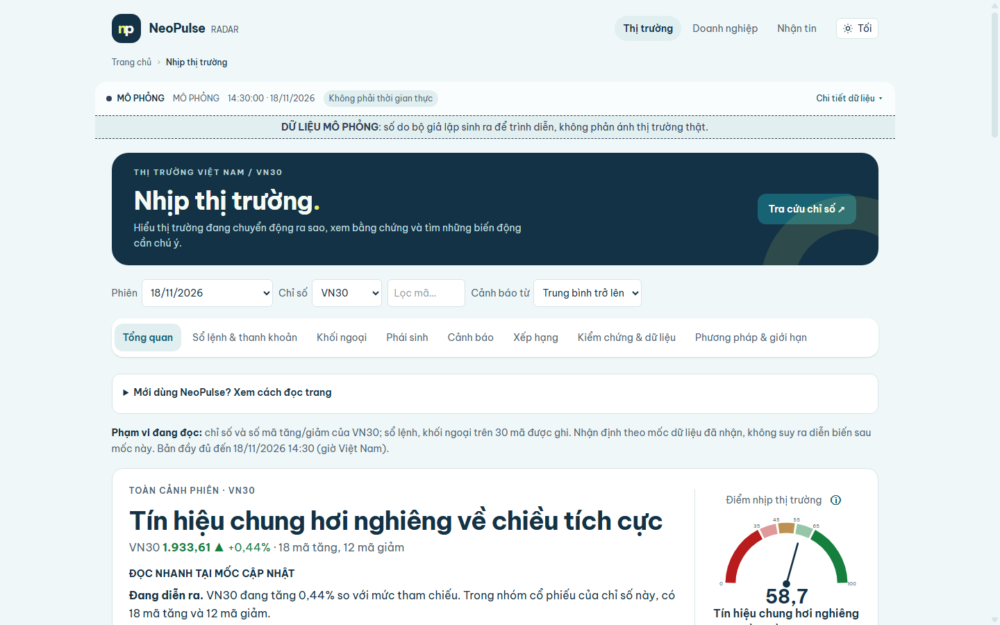 | 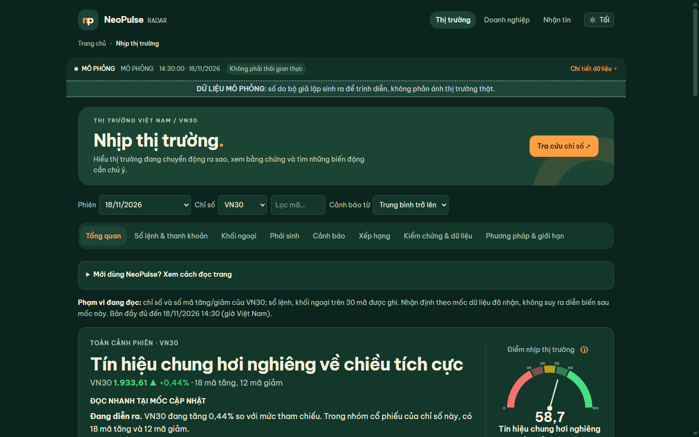 |

| Mobile `390×844` — Màn hình đầu tiên | Mobile `390×844` — Menu `Thêm` ở thanh đáy | Mobile `390×844` — Tab Cảnh báo |
|---|---|---|
| 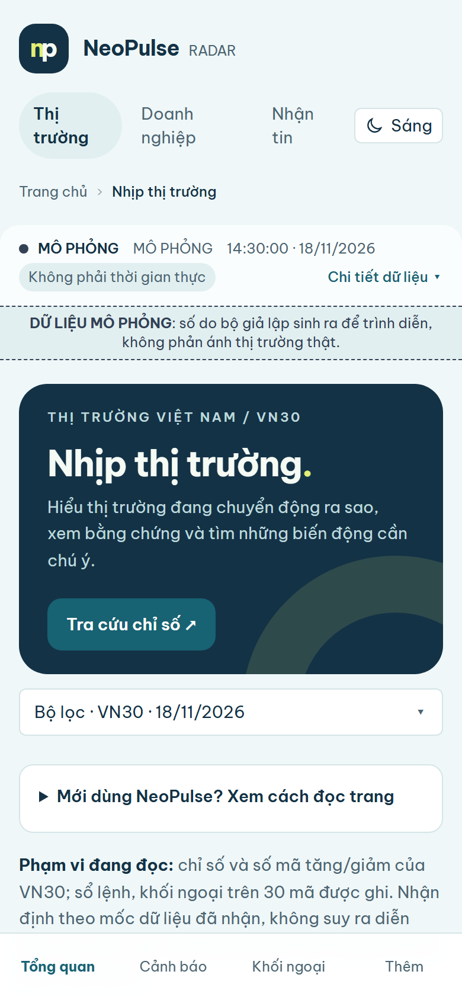 | 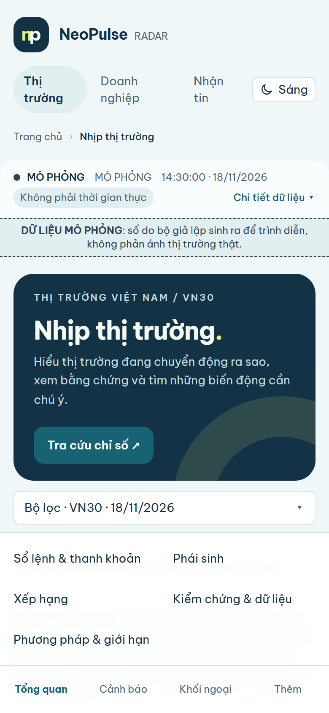 | 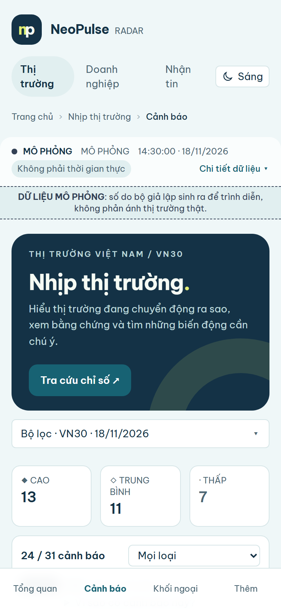 |

| Desktop — Tab Sổ lệnh (Treemap) | Desktop — Tab Khối ngoại | Desktop — Tab Cảnh báo |
|---|---|---|
| 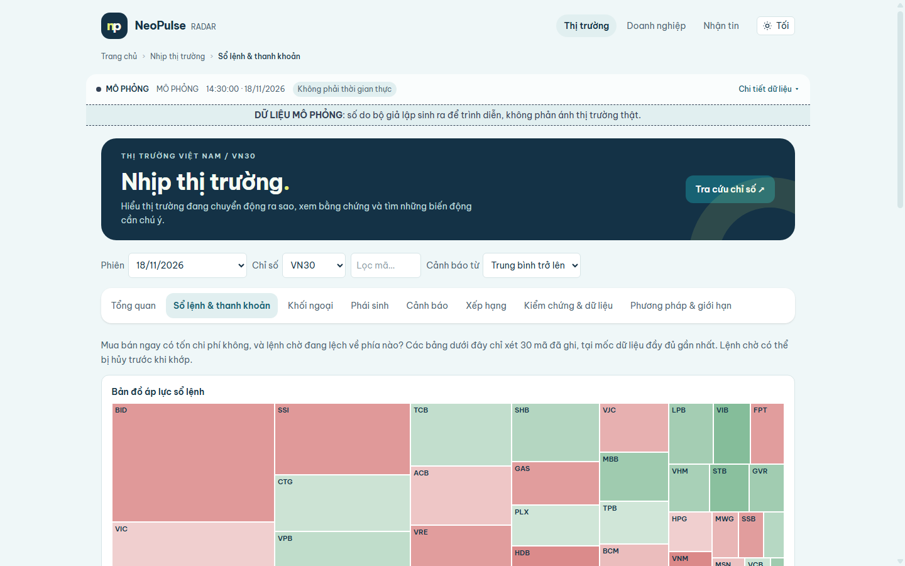 | 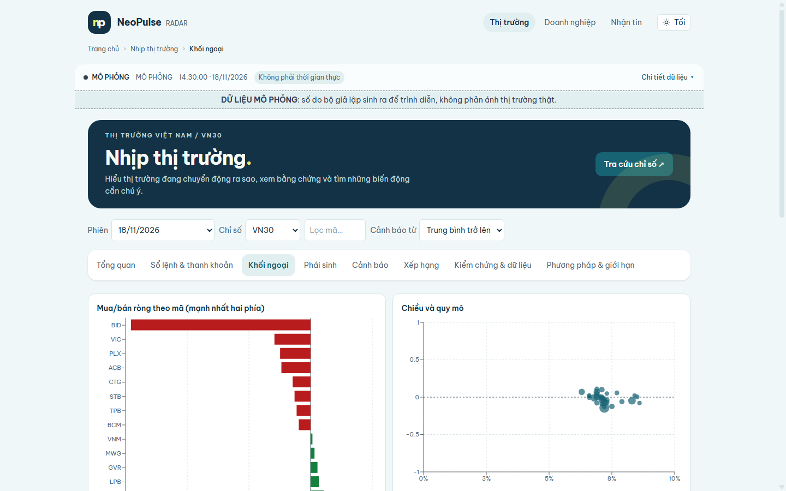 | 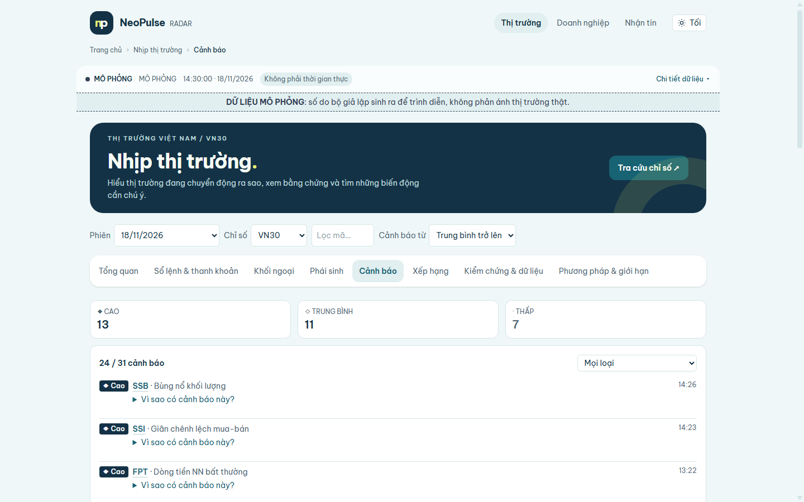 |

| Desktop — Hồ sơ doanh nghiệp (`FPT`) | Mobile — Hồ sơ doanh nghiệp (`FPT`) |
|---|---|
| 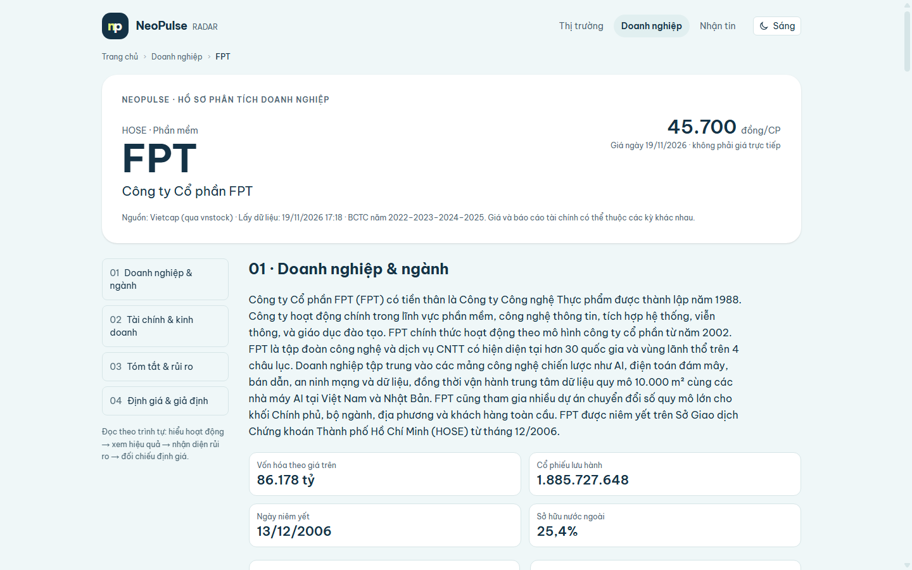 | 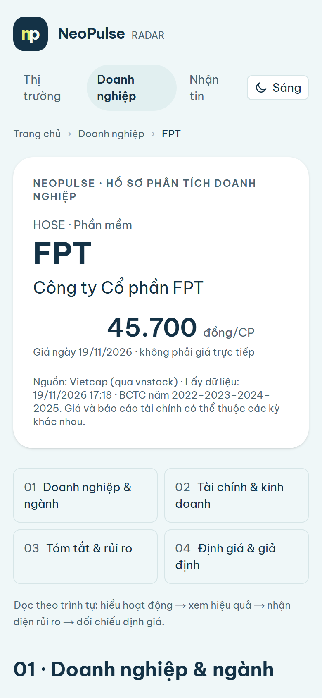 |

---

### 1.4. Danh sách vấn đề gây rối (phân loại theo mức độ)

#### A. Thứ tự thông tin & vùng nhìn đầu tiên (Nghiêm trọng)
1. **Hero trang trí `Nhịp thị trường.` chiếm 162 px (desktop) và 245 px (mobile)** trên mọi tab của trang `/`. Kiểu hero này hợp trang đích `/trang-chu`, nhưng trên dashboard dữ liệu lại đẩy toàn bộ chỉ số, điểm nhịp và cảnh báo ra ngoài vùng nhìn đầu tiên — đặc biệt nghiêm trọng khi chuyển sang tab `Cảnh báo` trên mobile (xem `before_mobile_alerts.png`: danh sách cảnh báo bị đẩy tụt xuống sau thanh đáy).
2. **Thông tin trùng lặp 3 lần ở đỉnh trang:** Thanh trạng thái hiện `● MÔ PHỎNG` cạnh `MÔ PHỎNG` (do `freshness().label` trùng `meta.source_label`), và ngay bên dưới lại có thêm một dải viền đứt `DỮ LIỆU MÔ PHỎNG: ...`.
3. **Top nav trên mobile `390 px` bị rớt dòng xấu:** Ba nút `Thị trường`, `Doanh nghiệp`, `Nhận tin` bị bẻ thành 2 dòng (`Thị / trường`, `Doanh / nghiệp`, `Nhận / tin`) trong các viên thuốc hẹp, làm header cao tới `114 px`.

#### B. Kiến trúc 8 tab dàn phẳng & luồng phân tích đứt gãy (Nghiêm trọng)
4. **8 tab ngang hàng không thể hiện được mạch 3 câu hỏi:** Người dùng lần đầu (giảng viên, nhà đầu tư) thấy 8 nhãn học thuật ngang nhau (`Sổ lệnh & thanh khoản`, `Khối ngoại`, `Phái sinh`, `Xếp hạng`, `Kiểm chứng & dữ liệu`, `Phương pháp & giới hạn`) mà không biết trình tự đọc.
5. **Thanh đáy mobile bất cân xứng:** Ghim cố định `Khối ngoại` ở thanh đáy trong khi `Sổ lệnh`, `Phái sinh`, `Xếp hạng`, `Kiểm chứng`, `Phương pháp` bị giấu trong ngăn kéo `Thêm` — khó khám phá.
6. **Không có luồng "Chi tiết mã nội phiên" thống nhất:**
   - Khối "Soi một mã" bị giấu ở đáy tab `Sổ lệnh & thanh khoản`, chỉ đổi bằng dropdown `<select>`.
   - `Treemap` áp lực sổ lệnh chỉ in tên mã (`BID`, `SSI`, `TCB`), không có tooltip số liệu, không có chú giải màu rõ tại chỗ, và **bấm vào ô không làm gì cả**.
   - Đồ thị phân tán Khối ngoại ("Chiều và quy mô") gom chấm thành một cụm cùng màu xanh teal, **tooltip không hiện tên mã** (`labelFormatter={() => ""}`) và không bấm đi sâu được.
   - Bấm mã trong Cảnh báo hoặc Ngành nhảy hẳn sang `/doanh-nghiep/[symbol]`, mất toàn bộ chỉ báo nội phiên (OBI₃, spread, trượt giá, cảnh báo của chính mã đó).

#### C. Bộ lọc phân tán & nhãn mơ hồ (Trung bình)
7. **Bộ lọc toàn cục xuất hiện cả nơi không dùng:** Ô `Lọc mã…` và `Cảnh báo từ` luôn hiện trên đầu trang ngay cả ở tab `Phái sinh`, `Kiểm chứng`, `Phương pháp` (không tác dụng gì), trong khi bộ lọc `Loại cảnh báo` lại nằm riêng bên trong thẻ ở tab `Cảnh báo`.
8. **3 thẻ đếm cảnh báo (`◆ CAO: 13`, `◇ TRUNG BÌNH: 11`, `· THẤP: 7`)** nhìn như bộ lọc nhanh nhưng không bấm được; còn nội dung cảnh báo lại bị giấu sau `<details>Vì sao có cảnh báo này?</details>`, bắt người dùng bấm từng dòng mới biết chuyện gì xảy ra.
9. **Tương phản & nhãn nút nhỏ:**
   - Nút `Tra cứu chỉ số ↗` ở Light mode dùng nền `--accent` (`#176273`) đặt lên nền hero `--hero-bg` (`#143246`) — chênh lệch sáng tối giữa nút và nền rất thấp (nhìn chìm, trong khi Dark mode dùng cam `#FF9F43` nổi rõ).
   - Nút `ThemeToggle` hiển thị biểu tượng ngược với nhãn chữ (đang ở Sáng nhưng hiện hình Mặt trăng + chữ `Sáng`), đồng thời gây lỗi WCAG 2.5.3 `label-content-name-mismatch` (tương tự ở logo `NeoPulse RADAR` và các nút `<Term>`).
   - Ở `/doanh-nghiep/[symbol]` mobile, giá cổ phiếu (`45.700 đồng/CP`) căn phải (`text-right`) nên bị lệch lơ lửng khi xếp dọc.

#### D. Trạng thái tải, hiệu năng & hệ thống hiệu ứng (Trung bình)
10. **CLS = `0,057` & TBT = `400 ms`:**
    - Thẻ `Guide` ("Mới dùng NeoPulse?") render `null` ở SSR rồi bật `show = true` trong `useEffect`, đẩy toàn bộ trang tụt xuống `58 px` sau khi tải xong.
    - `TechnicalChart` (`lightweight-charts`) nạp trực tiếp (eager) vào `Overview`, kéo First Load JS từ `117 kB` lên `195 kB` và gây `22,4 kB` JS chưa dùng ở lần vẽ đầu.
11. **Skeleton & trạng thái tải sơ sài:** Chuyển tab phụ chỉ hiện dòng chữ trần `Đang tải…` không có khung giữ chỗ, gây giật bố cục.
12. **Hiệu ứng chưa hệ thống hóa:** Đã có `.flash-up / .flash-down / .flash-flat` (500 ms) và `.gauge-needle` (900 ms) cùng quy tắc `prefers-reduced-motion`, nhưng:
    - Chưa có motion tokens chuẩn hóa (thời lượng/easing rải rác);
    - Thiếu chuyển tab mượt (panel fade/slide nhẹ 180 ms), thiếu hiệu ứng xuất hiện cảnh báo live mới, thiếu shimmer/skeleton tải chart & bảng, thiếu phản hồi nhấn/hover nhất quán trên thẻ tương tác.

---

## Phần 2. Đề xuất cải tiến (CHỜ DUYỆT TRƯỚC KHI TRIỂN KHAI)

### 2.1. Kiến trúc thông tin mới: 8 tab → 5 tab theo hành trình 5 bước

Gộp, đổi tên và sắp xếp lại theo đúng mạch tư duy của người đọc thị trường và giảng viên chấm bài:

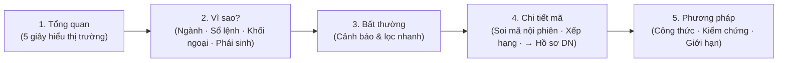

| Tab mới | Slug chính | Nội dung bên trong | Tương thích URL cũ (tự chuyển đúng mục) |
|---|---|---|---|
| **1. Tổng quan** | `tong-quan` | Trả lời nhanh 3 câu hỏi ("Khỏe hay yếu?", "Vì sao?", "Có gì bất thường?") ngay trên màn hình đầu + Biểu đồ diễn biến giá + Ngành kéo/đè + Tóm tắt kiểm chứng | `?tab=tong-quan` |
| **2. Vì sao?** | `vi-sao` | Có thanh phân mục con (pill switcher): **`Ngành & Độ rộng`** · **`Sổ lệnh & Thanh khoản`** (Treemap tương tác + bảng thanh khoản) · **`Khối ngoại`** (biểu đồ + scatter có nhãn mã + bảng) · **`Phái sinh`** (Basis HĐTL). Cho phép xem liên mạch không phải nhảy tab lớn | `?tab=so-lenh` → `vi-sao` (Sổ lệnh)<br>`?tab=khoi-ngoai` → `vi-sao` (Khối ngoại)<br>`?tab=phai-sinh` → `vi-sao` (Phái sinh) |
| **3. Bất thường** | `canh-bao` | 3 thẻ đếm `◆ Cao` / `◇ Trung bình` / `· Thấp` **bấm để lọc trực tiếp** + lọc loại quy tắc & mã ngay trên thanh đầu thẻ; mỗi dòng hiển thị sẵn tóm tắt 1 dòng bằng lời thường + mở rộng số đo/ngưỡng + nút đi sâu thẳng sang `Chi tiết mã` | `?tab=canh-bao` |
| **4. Chi tiết mã** | `chi-tiet-ma` | **Gộp "Soi một mã" nội phiên + "Xếp hạng đa yếu tố"**: đầu tab là ô chọn/tìm nhanh mã trong rổ → hiện thẻ tổng hợp 1 mã (giá, % đổi, OBI₃, spread, trượt giá, dòng tiền NN, cảnh báo riêng của mã, đồ thị giá giữa/OBI₃ theo phút) + nút **"Mở hồ sơ doanh nghiệp [MÃ] →"** (`/doanh-nghiep/[symbol]`). Bên dưới là bảng **Xếp hạng đa yếu tố** bấm từng dòng để đổi mã đang soi ngay lập tức | `?tab=xep-hang` → `chi-tiet-ma` (tập trung bảng Xếp hạng)<br>`?tab=chi-tiet-ma&sym=FPT` → mở thẳng mã FPT |
| **5. Phương pháp** | `phuong-phap` | 2 phân mục con: **`Phương pháp & Giới hạn`** (chuỗi xử lý, bảng công thức, 9 giới hạn, miễn trừ) và **`Kiểm chứng & Dữ liệu`** (bảng IC trong/ngoài mẫu, biểu đồ IC từng phiên, chất lượng dữ liệu) | `?tab=phuong-phap`<br>`?tab=kiem-chung` → `phuong-phap` (Kiểm chứng) |

> **Bảo toàn dữ liệu & kiểm thử:** Không bỏ bất kỳ bảng/biểu đồ/chỉ báo nào hiện có; toàn bộ mục trong `GLOSSARY` và các link cũ (`/?tab=kiem-chung`, `/?tab=so-lenh`,…) vẫn dẫn chính xác đến đúng vị trí.

---

### 2.2. Màn Tổng quan: thứ tự khối & vùng nhìn đầu tiên (Above the fold)

**Nguyên tắc chung cho cả 2 phương án:**
- **Bỏ khối `feature-hero` trang trí lớn (162–245 px) trên trang `/`**, chỉ giữ cho `/trang-chu` và `/thong-bao`. Trang `/` là công cụ theo dõi trong phiên nên dữ liệu thị trường chính là "hero".
- **Thanh trạng thái dữ liệu 1 dòng thông minh:** Gộp nhãn trạng thái + nguồn (khử lỗi lặp `MÔ PHỎNG MÔ PHỎNG`), giữ rõ chấm/pill trạng thái (`TRỰC TIẾP` / `Snapshot cuối phiên` / `Snapshot giữa phiên` / `MÔ PHỎNG` / `Ngoài giờ` / `Lỗi`), giờ cập nhật và nút `Chi tiết dữ liệu ▾` để mở rộng số mã tính/loại, số phiên, tuổi dữ liệu. Với dữ liệu mô phỏng vẫn giữ cảnh báo rõ ràng nhưng cô đọng (không chiếm 2 tầng trùng lặp).
- **Tải lười `TechnicalChart` (`next/dynamic`)** kèm skeleton cố định chiều cao → hạ First Load JS từ `195 kB` xuống gần mức `~120–130 kB` và giảm TBT/LCP đáng kể.
- **Khử CLS của `Guide`:** Đưa hướng dẫn đọc trang thành nút nhỏ gọn (`? Cách đọc`) cạnh `Tra cứu chỉ số ⓘ` thay vì chèn 1 hộp `58 px` bung ra sau hydration.
- **Luôn có dòng miễn trừ** *"Công cụ phân tích học thuật. Không phải lời khuyên đầu tư."* rõ ràng ở chân trang và màn lỗi/rỗng.

---

### 2.3. Điều hướng mobile, hành vi bộ lọc & luồng đi sâu

1. **Thanh điều hướng đáy mobile (5 mục cố định, bỏ menu `Thêm`):**
   - `Tổng quan` · `Vì sao` · `Cảnh báo` (kèm chấm/số lượt CAO nếu > 0) · `Chi tiết mã` · `Phương pháp`.
   - Mỗi nút rộng `≥ 72 px` ở màn `360 px`, cao `56 px` (`min-h-14`), có icon SVG nét mảnh + nhãn 1 dòng ngắn gọn, hỗ trợ `pb-[env(safe-area-inset-bottom)]` và `aria-current="page"`.
   - Top header mobile gọn thành **1 hàng duy nhất**: Logo gọn + chọn nhanh `VN30 ▾` + `Tra cứu ⓘ` + đổi giao diện; link sang `Doanh nghiệp` / `Nhận tin` xếp thành dải cuộn ngang mảnh `whitespace-nowrap` không bao giờ rớt 2 dòng.

2. **Hành vi bộ lọc theo ngữ cảnh (Contextual Filters):**
   - **Toàn cục (luôn hiện, gọn ở thanh tab):** `Chỉ số` (`VN30`, `VNINDEX`…) và `Phiên` (`Mới nhất` hoặc ngày lịch sử).
   - **Cục bộ (chỉ hiện ở tab sử dụng):**
     - `Lọc mã…` chỉ hiện ở `Vì sao?` (Sổ lệnh/Khối ngoại), `Bất thường` và `Chi tiết mã`.
     - `Mức cảnh báo` (`CAO` / `TRUNG BÌNH` / `THẤP`) đặt trực tiếp trong tab `Bất thường` (bấm ngay trên 3 thẻ thống kê) và đồng bộ về tóm tắt cảnh báo ở `Tổng quan`.
   - Khi đang có bộ lọc hoạt động (lọc mã, lọc ngày cũ, lọc mức cảnh báo) → hiện chip trạng thái có nút `× Xóa lọc` để không bao giờ quên mình đang lọc.

3. **Luồng đi sâu (Drill-down) từ Cảnh báo / Biểu đồ → Chi tiết mã → Hồ sơ doanh nghiệp:**
   - **Bấm mã cổ phiếu** trong Cảnh báo, Treemap Sổ lệnh (thêm tooltip `Mã · GT khớp · OBI₃` + click), Biểu đồ Khối ngoại (thêm tooltip hiện rõ tên mã + click), Bảng Ngành mở rộng, hoặc Bảng Xếp hạng → chuyển mượt sang tab **`Chi tiết mã`** với mã đó được chọn sẵn (giữ nguyên phiên & chỉ số đang xem).
   - Trong `Chi tiết mã`, luôn có nút nổi bật **`Mở hồ sơ doanh nghiệp [MÃ] →`** đi sang `/doanh-nghiep/[symbol]` (có breadcrumb quay lại đúng phiên đang xem).

---

### 2.4. Hệ thống hiệu ứng có mục đích (Motion System)

Chuẩn hóa toàn bộ chuyển động qua CSS custom properties trong `globals.css` và **tắt hoàn toàn** (`animation-duration: 0.01ms !important; transition-duration: 0.01ms !important`) khi `@media (prefers-reduced-motion: reduce)`:

| Token / Hiệu ứng | Mục đích UX | Thời lượng | Easing | Phạm vi áp dụng |
|---|---|---:|---|---|
| `--dur-fast` (`150ms`) | Phản hồi hover/active trên nút, tab, dòng bảng, chip lọc | `150 ms` | `cubic-bezier(0.2, 0, 0, 1)` | Mọi nút, hàng bảng tương tác, chip bộ lọc |
| `--dur-panel` (`200ms`) | Chuyển tab / phân mục con mượt, giữ mắt không bị "nhảy cứng" | `200 ms` | `cubic-bezier(0.22, 1, 0.36, 1)` | `#tabpanel` fade + translateY `4px → 0` |
| `--dur-flash` (`450ms`) | **Nháy nền khi số trực tiếp đổi** (xanh lá tăng, đỏ giảm, vàng đứng giá) | `450 ms` | `ease-out` | Chỉ số `VN30`, giá cổ phiếu, điểm nhịp khi nhận tick live |
| `--dur-enter` (`260ms`) | **Xuất hiện cảnh báo mới** (khi có tin live mới đẩy lên đầu danh sách) | `260 ms` | `cubic-bezier(0.22, 1, 0.36, 1)` | Dòng cảnh báo mới (`opacity` + viền nhấn dịu trong 600ms) |
| `--dur-gauge` (`650ms`) | Kim đồng hồ điểm nhịp quét mượt 1 lần khi mở (rút từ `900ms` xuống gọn hơn) | `650 ms` | `cubic-bezier(0.16, 1, 0.3, 1)` | `Gauge` trên Tổng quan |
| **Skeleton Shimmer** | Giữ đúng chiều cao khối khi tải lười biểu đồ / tab phụ, triệt tiêu CLS | `1400 ms` (vòng nhẹ) | `ease-in-out` | Biểu đồ `TechnicalChart`, các tab phụ, trạng thái `loading.tsx` |
| **Tooltip biểu đồ** | Hiện mượt, bám crosshair, đọc rõ ở cả Light/Dark mode (WCAG AA) | `120 ms` | `ease-out` | Recharts (`TOOLTIP_STYLE` nâng cấp) & TradingView crosshair |
| **Ngăn Tra cứu `<dialog>`** | Trượt nhẹ từ mép phải trên desktop / đáy lên trên mobile (`@starting-style` + fallback) | `220 ms` | `cubic-bezier(0.22, 1, 0.36, 1)` | `Glossary` modal |

**Tuyệt đối không dùng:** hiệu ứng nảy/phóng to gây rối mắt, parallax, hay nhấp nháy liên tục trên chữ/số đứng yên.

---

### 2.5. Hai phương án phác thảo cho màn Tổng quan (MỜI CHỌN 1)

#### Phương án A — "Bản tin Cô đọng" (Editorial Brief)
*Giữ mạch kể chuyện từ trên xuống quen thuộc cho giảng viên chấm bài, nhưng loại bỏ hoàn toàn chrome thừa để toàn bộ Điểm nhịp + Đọc nhanh + 5 Bằng chứng nằm trọn trên màn hình đầu tiên.*

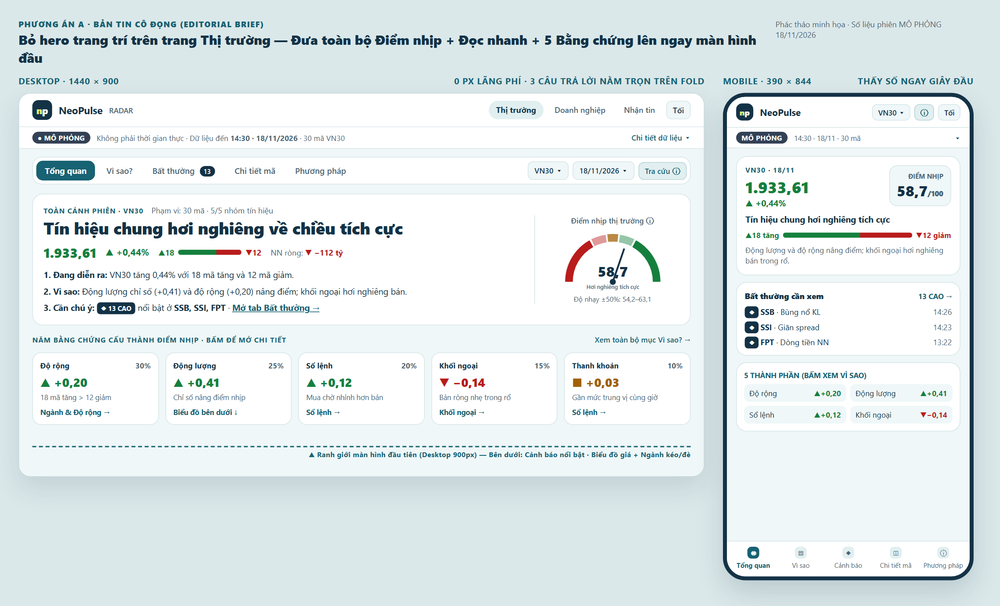

```text
DESKTOP 1440×900 (ABOVE THE FOLD)
┌────────────────────────────────────────────────────────────────────────────┐
│ [np] NeoPulse RADAR                    [Thị trường] Doanh nghiệp Nhận tin ◐│
├────────────────────────────────────────────────────────────────────────────┤
│ ● MÔ PHỎNG · Không phải thời gian thực · 14:30 · 18/11 · 30 mã   Chi tiết ▾│
├────────────────────────────────────────────────────────────────────────────┤
│ [Tổng quan] Vì sao?  Bất thường (13)  Chi tiết mã  Phương pháp |VN30▾|18/11▾|ⓘ│
├────────────────────────────────────────────────────────┬───────────────────┤
│ TOÀN CẢNH PHIÊN · VN30                                 │  Điểm nhịp ⓘ      │
│ Tín hiệu chung hơi nghiêng về chiều tích cực           │    ╭───╮          │
│ 1.933,61  ▲+0,44%  ▲18 [████░░░] ▼12  NN: ▼−112 tỷ     │   / 58,7\         │
│ 1. Đang diễn ra: VN30 tăng 0,44%, 18 tăng / 12 giảm    │  Hơi tích cực     │
│ 2. Vì sao: Động lượng & độ rộng nâng điểm...           │  Độ nhạy ±50%     │
│ 3. Cần chú ý: ◆ 13 CAO ở SSB, SSI, FPT · Xem cảnh báo →│                   │
├────────────┬────────────┬────────────┬────────────┬────┴───────────────────┤
│ Độ rộng 30%│Động lg 25% │Sổ lệnh 20% │Khối ng 15% │Thanh khoản 10%         │
│ ▲ +0,20    │▲ +0,41     │▲ +0,12     │▼ −0,14     │■ +0,03                 │
│ Ngành →    │Biểu đồ ↓   │Sổ lệnh →   │Khối ngoại →│Sổ lệnh →               │
└────────────┴────────────┴────────────┴────────────┴────────────────────────┘
  ▼ Dưới fold: Cảnh báo đáng chú ý (5 dòng) → Biểu đồ giá + Ngành kéo/đè → Kiểm chứng
```

#### Phương án B — "Bàn điều khiển 3 Cột" (Radar Cockpit)
*Tổ chức dạng lưới Bento 3 cột ngang hàng: trả lời **đồng thời** cả 3 câu hỏi ("1. Khỏe hay yếu?", "2. Vì sao?", "3. Bất thường?") trên cùng một tầm mắt trong 5 giây, kèm phần mở đầu của Biểu đồ giá và Ngành kéo/đè ngay trong màn hình đầu tiên. Giảm >50% chiều dài cuộn.*

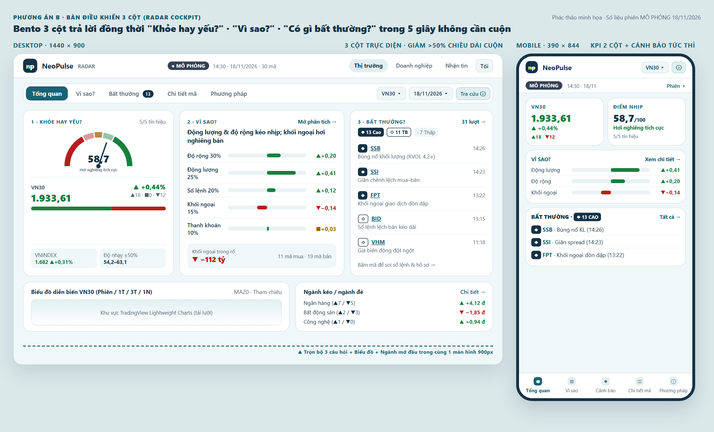

```text
DESKTOP 1440×900 (ABOVE THE FOLD)
┌────────────────────────────────────────────────────────────────────────────┐
│ [np] NeoPulse   [● MÔ PHỎNG · 14:30 · 18/11 · 30 mã]   Thị trường|DN|Tin|◐ │
├────────────────────────────────────────────────────────────────────────────┤
│ [Tổng quan] Vì sao?  Bất thường (13)  Chi tiết mã  Phương pháp |VN30▾|18/11▾|ⓘ│
├─────────────────────────┬──────────────────────────┬───────────────────────┤
│ 1 · KHỎE HAY YẾU?       │ 2 · VÌ SAO?  Phân tích → │ 3 · BẤT THƯỜNG? 31 →  │
│      ╭───╮              │ Động lượng & độ rộng kéo │ [◆13 Cao][◇11][·7]    │
│     / 58,7\             │ Độ rộng    [   |██] ▲+0,2│ ◆ SSB · Bùng nổ KL    │
│ VN30  1.933,61  ▲+0,44% │ Động lượng [   |██] ▲+0,4│ ◆ SSI · Giãn spread   │
│ ▲18 [██████░░░░] ▼12    │ Sổ lệnh    [   |█ ] ▲+0,1│ ◆ FPT · NN dồn dập    │
│ ───────────┬─────────── │ Khối ngoại [ █|   ] ▼−0,1│ ◇ BID · Lệch sổ lệnh  │
│ VNINDEX    │Độ nhạy±50% │ Thanh kh.  [   |  ] ■+0,0│ ◇ VHM · Giá đột ngột  │
│ 1.682 ▲+0,3│ 54,2–63,1  │ NN ròng: ▼−112 tỷ        │ Bấm mã → Chi tiết mã  │
├─────────────────────────┴─────────────┬────────────┴───────────────────────┤
│ Biểu đồ diễn biến VN30 (tải lười)     │ Ngành kéo / ngành đè    Chi tiết → │
│ [Phiên] 1T 3T 6T 1N · MA20 · Tham chiếu│ Ngân hàng ▲+4,12 · BĐS ▼−1,85     │
└───────────────────────────────────────┴────────────────────────────────────┘
  ▼ Dưới fold: Toàn bộ biểu đồ & bảng ngành đầy đủ + Tóm tắt kiểm chứng + Footer
```

#### So sánh nhanh để chọn

| Tiêu chí | Phương án A — Bản tin Cô đọng | Phương án B — Bàn điều khiển 3 Cột |
|---|---|---|
| **Tốc độ trả lời 3 câu hỏi trên Desktop** | Rất nhanh (~5 giây, đọc từ trên xuống) | **Tức thì (~3 giây, cả 3 cột cùng tầm mắt)** |
| **Chiều dài cuộn Tổng quan (Desktop)** | ~2.800 px (giảm ~35%) | **~2.100 px (giảm >50%)** |
| **Trải nghiệm Mobile 390 px** | Rất thoáng, đọc mạch văn tự nhiên | Gọn theo cặp KPI 2 cột + thanh thanh phần + cảnh báo |
| **Ấn tượng khi demo giảng viên & đưa vào CV** | Sạch sẽ, gần phong cách báo cáo học thuật / bản tin tài chính | **Đậm chất sản phẩm FinTech chuyên nghiệp**, trực quan khi chiếu máy chiếu & ảnh chụp CV |
| **Độ khớp với bộ test hiện tại (`glossary.test.ts`)** | Giữ nguyên mạch `Năm góc nhìn → Cảnh báo → Biểu đồ` | Cần cập nhật thứ tự assert DOM của 1 test trong `glossary.test.ts` sau khi duyệt |

> **Khuyến nghị của Product Designer:** **Phương án B (Bàn điều khiển 3 Cột)** tạo bước nhảy rõ rệt nhất cả về tốc độ nắm bắt 5 giây, độ ấn tượng khi đưa vào CV FinTech, lẫn khả năng trình chiếu trước giảng viên mà vẫn giữ đủ bảng giải thích, độ nhạy trọng số và từ điển ⓘ. Nếu bạn muốn giữ văn phong kể chuyện đọc xuôi nhiều chữ hơn, chọn **Phương án A**.

---

## Phần 3. Kết quả kiểm tra trước / sau (đã chốt Phương án B + 4 điều kiện)

### 3.1. Các điều kiện đã chốt từ chủ dự án & cách hiện thực hóa

1. **Cột “2 · Vì sao?” giữ câu giải thích thường + nhãn thành phần chuẩn hóa:** Hiển thị ngay khối giải thích 1–2 câu từ hai thành phần tác động mạnh nhất (`componentMeaning`) và ghi rõ *"Các thanh dưới đây là thành phần chuẩn hóa (−1…+1) theo trọng số gốc — không phải % tăng giá hay số điểm đóng góp"*.
2. **Thu nhỏ đồng hồ & tận dụng cột trái; không ép biểu đồ/ngành vào màn hình đầu:** Thu gọn `Gauge` (`max-w-[215px]`) để hiển thị đồng thời điểm nhịp, chỉ số `VN30`, thanh độ rộng trực quan, câu tóm tắt, thông báo phân kỳ/thiếu dữ liệu, độ phủ `X/5` và độ nhạy trọng số `±50%` ngay trong cột trái. `TechnicalChart` (tải lười qua `next/dynamic` + `IntersectionObserver`, chiều cao đầy đủ `h-72 sm:h-96`) và `SectorCard` nằm rộng rãi ngay bên dưới Bento.
3. **Mobile ưu tiên hai số chính → lý do ngắn → cảnh báo:** Trên màn `390×844`, khối đầu hiển thị ngay thẻ đôi `VN30 1.933,61 ▲ +0,44%` | `Điểm nhịp 58,7/100`, thanh độ rộng và câu tóm tắt; khối kế tiếp hiển thị lý do ngắn kèm nhãn rõ **`3 tín hiệu nổi bật`** và nút **`Mở đủ 5 tín hiệu ▾`**; tiếp theo là cảnh báo và thanh điều hướng đáy 5 mục cố định.
4. **Nguồn, thời điểm, thiếu dữ liệu & tra cứu `ⓘ` tại chỗ:** `StatusBar` khử lặp `MÔ PHỎNG`, giữ rõ nguồn/giờ/không phải thời gian thực/mã bị loại; dải phạm vi trên Tổng quan báo luôn chuỗi thời gian ghi nhận thực tế (và gắn cờ **`Thiếu đầu phiên · ghi từ HH:MM–HH:MM`** khi dữ liệu bắt đầu sau `09:20`). Mọi nút `ⓘ` mở ngăn `Tra cứu chỉ số` ngay tại chỗ không mất bộ lọc/phiên đang xem.

---

### 3.2. Bảng so sánh Trước / Sau (phiên mô phỏng `18/11/2026`, `VN30`)

| Chỉ số | Trước (`main`) | Sau (`ui/refine`) | Thay đổi |
|---|---:|---:|---|
| **Lighthouse Mobile — Performance** | **76** | **86** | **+10 điểm** |
| **Lighthouse Mobile — Accessibility** | **100** *(1 cảnh báo WCAG 2.5.3)* | **100** *(0 lỗi, 0 cảnh báo)* | Sạch hoàn toàn |
| **Lighthouse Mobile — Best Practices** | **100** | **100** | Giữ nguyên tối đa |
| **LCP (Mobile)** | `4,2 s` | `3,4 s` | **−0,8 s (−19%)** |
| **TBT (Mobile)** | `400 ms` | `270 ms` | **−130 ms (−33%)** |
| **CLS (Mobile)** | `0,057` | **`0`** | **Triệt tiêu hoàn toàn** |
| **First Load JS trang `/`** | `195 kB` | **`143 kB`** | **−52 kB (−27%)** |
| Vị trí nội dung thị trường đầu tiên — Desktop `1440×900` | `y = 674 px` *(cắt nửa dưới)* | **`y = 245 px`** *(trọn cả 3 cột `245–872 px`)* | **Trọn 3 câu hỏi trên fold** |
| Vị trí nội dung thị trường đầu tiên — Mobile `390×844` | `y = 849 px` *(0% trên fold)* | **`y = 367 px`** *(trọn cột 1 + đầu cột 2)* | **Thấy số ngay giây đầu** |
| Chiều cao cuộn tab Tổng quan (Desktop / Mobile) | `4.312 px` / `8.211 px` | `3.208 px` / `5.371 px` | **−26% desktop / −35% mobile** |
| Số tab chính (Desktop & Mobile) | 8 tab *(5 tab giấu trong `Thêm`)* | **5 tab** *(hiện đủ 5 mục ở thanh đáy)* | Bỏ ngăn kéo `Thêm` |
| Kiểm thử tự động (`lint`, `test`, `build`) | 91/91 | **94/94** *(0 lỗi, 0 cảnh báo ESLint)* | Thêm 3 test `ux-refine.test.ts` |

---

### 3.3. Kiểm tra kỹ thuật chi tiết

- **Điều hướng bàn phím & Focus:** Phím `ArrowRight` / `ArrowLeft` / `Home` / `End` trên `role="tablist"` của cả 5 tab chính lẫn sub-tab `Vì sao?` và `Phương pháp` chuyển tab, cập nhật `aria-selected` và dời focus đúng (`tab-tong-quan` → `tab-vi-sao`); vòng focus (`:focus-visible`) rõ nét ở cả Sáng và Tối; ngăn `<dialog>` Tra cứu giữ focus (focus trap) và đóng bằng `Escape`.
- **Đi sâu (Drill-down):** Bấm mã `SSB` trong cảnh báo → chuyển thẳng tới `?date=2026-11-18&index=VN30&tab=chi-tiet-ma&sym=SSB`, hiển thị đầy đủ giá, OBI₃, spread, trượt giá, điểm thanh khoản, khối ngoại, cảnh báo riêng của `SSB` và nút mở hồ sơ doanh nghiệp `/doanh-nghiep/SSB`. Tương thích ngược URL cũ `?tab=so-lenh`, `khoi-ngoai`, `phai-sinh`, `xep-hang`, `kiem-chung`.
- **Tương phản WCAG AA (Sáng & Tối):** Sau lần đo Lighthouse đầu phát hiện `--down` (`#f87171`) trên nền `surface-2` dark mode đạt `4,15`, đã nâng lên `#ff8a8a` (≥ `5,3:1`) và thêm tên truy cập ẩn (`sr-only sm:not-sr-only`) cho nút `?` trên mobile → đạt **Accessibility 100, 0 lỗi**.
- **`prefers-reduced-motion: reduce`:** Đã xác nhận qua Chrome DevTools emulation: `animationDuration = 1e-05s`, `transitionDuration = 1e-05s` — tắt hoàn toàn mọi hiệu ứng chuyển động.
- **Tràn ngang ở `360 px`:** `0` lỗi tràn ngang (`scrollWidth <= innerWidth`) trên tất cả 5 tab mới, 4 slug cũ và 4 trang phụ (`/trang-chu`, `/doanh-nghiep`, `/doanh-nghiep/FPT`, `/thong-bao`); không có lỗi runtime trên console.

---

### 3.4. Ảnh chụp Trước / Sau

| Màn hình | Trước (`main`) | Sau (`ui/refine`) |
|---|---|---|
| **Desktop `1440×900` — Tổng quan (Sáng)** |  | 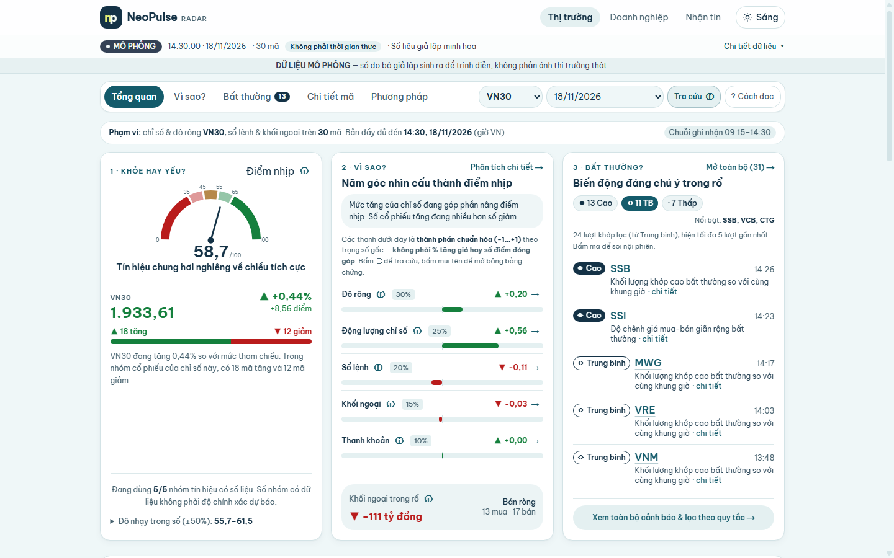 |
| **Desktop `1440×900` — Tổng quan (Tối)** |  | 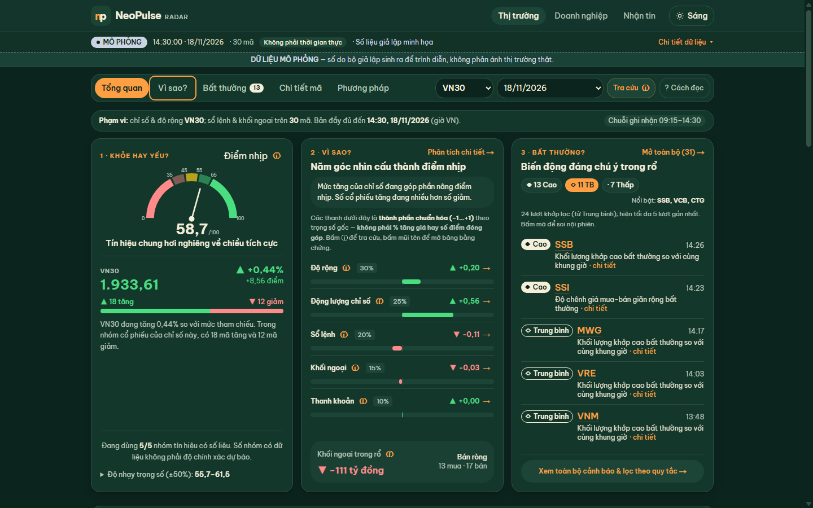 |
| **Mobile `390×844` — Tổng quan** |  | 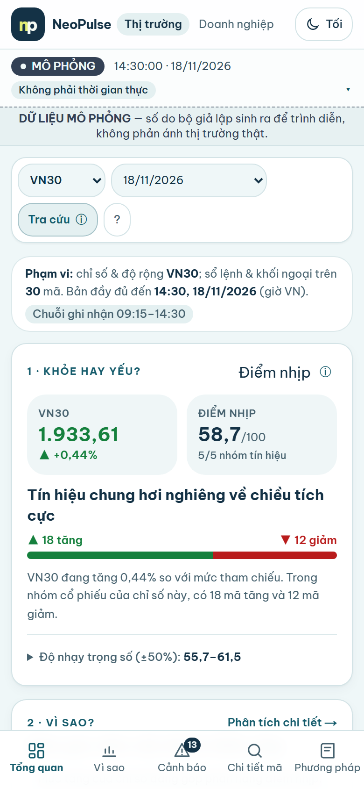 |
| **Desktop — Bất thường (Cảnh báo)** |  | 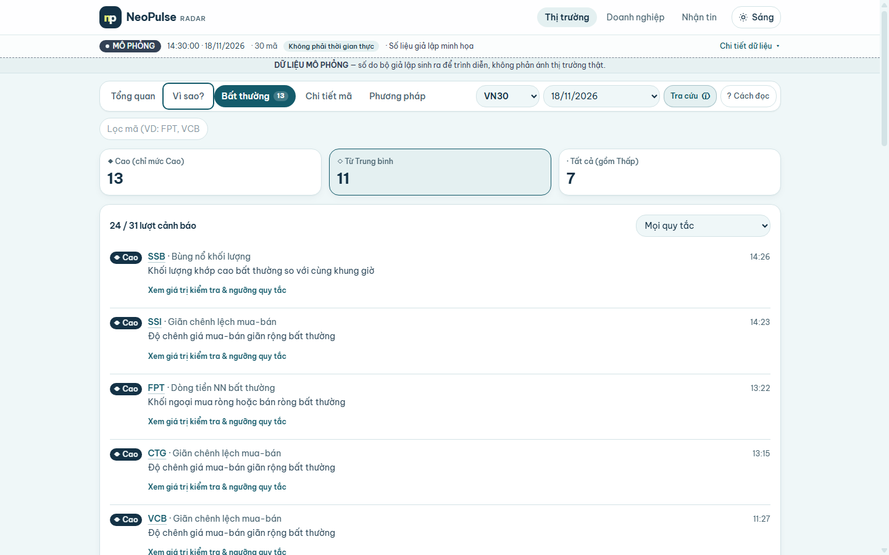 |
| **Mobile `390×844` — Bất thường (Cảnh báo)** |  | 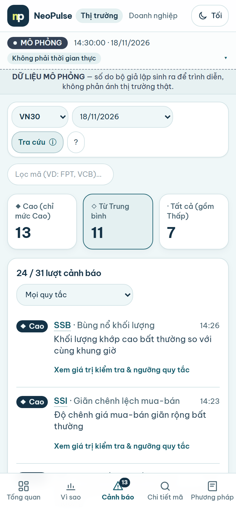 |
| **Desktop — Chi tiết mã (đi sâu từ `SSB`)** | *(trước bị giấu ở đáy tab Sổ lệnh)* | 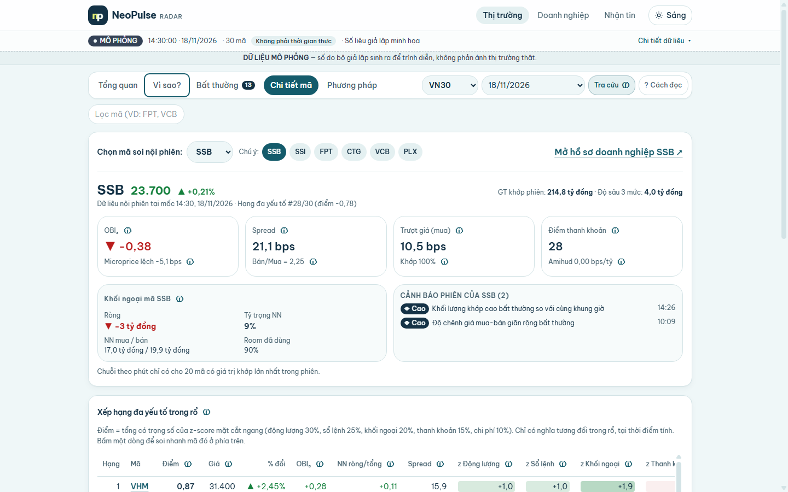 |
| **Mobile `390×844` — Chi tiết mã** | *(trước không có tab riêng)* | 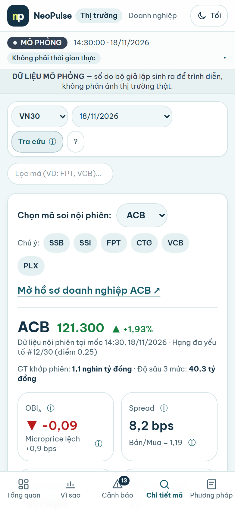 |

---

### 3.5. Những gì cố ý KHÔNG làm và lý do

1. **Không sửa Python (`src/`), công thức tài chính, lược đồ JSON, `/api/ably-token` hay middleware:** Đúng ranh giới kiến trúc *Python tính, web chỉ hiển thị* và ràng buộc của đồ án.
2. **Không biên tập lại câu chữ diễn giải học thuật/cảnh báo ngoài phạm vi bố cục:** Dành phần biên tập câu chữ cho agent/nhánh `copy/vi` để tránh xung đột khi hợp nhất.
3. **Không ép Biểu đồ và Bảng ngành vào màn hình đầu tiên trên Desktop:** Biểu đồ `TradingView Lightweight Charts` cần đủ chiều cao (`h-72 sm:h-96`) để đọc đường giá/MA/EMA và tương tác thu phóng; đặt ngay dưới khối Bento 3 cột kết hợp tải lười theo viewport giúp vừa đọc thoải mái vừa tăng 10 điểm Lighthouse Performance.
4. **Không thêm thư viện UI/animation bên thứ ba (như Framer Motion, Radix, TanStack Table):** Tận dụng CSS custom properties, `@starting-style`, `<dialog>` chuẩn HTML và `IntersectionObserver` giúp giảm First Load JS xuống `143 kB` và dễ bảo trì.
5. **Không chạm vào `/trang-chu`, `/doanh-nghiep`, `/thong-bao` ngoài đồng bộ header gọn và căn lề giá trên mobile:** Các trang đích này đã mạch lạc; giữ nguyên hero lớn trên `/trang-chu` đúng vai trò trang giới thiệu.

